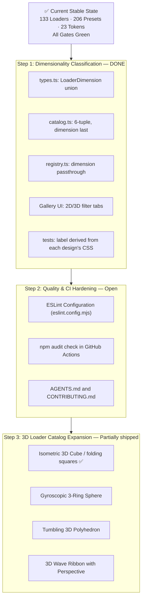

# Wavelo — Progress Tracker & Comprehensive Analysis Report

> **Last verified against code & tests:** 2026-11-01 (IST), on branch `dev`  
> **Catalog size:** **133 active designs / 206 named presets** (started at 83/120; Phase 1: 155 → 146, Phase 2: 146 → 141, Phase 3 Option 2: 141 → 133)  
> **Dimensionality:** 128 active 2D designs / 5 active 3D designs (`cube`, `folding-squares`, `helix`, `ellipse`, `rotating-square`), labelled from the transforms each design actually animates.  
> **Quality gates:** `npm run check` green — build, strict typecheck, 52 unit/adapter tests, catalog drift, 7-package metadata validation, documentation sync, bundle budgets.  
> **Browser validation:** three engines passing — **Chromium 36/36**, **Gecko 6/6**, **WebKit 7/7**.  
> **Layout cost:** **131 of 133** designs cost 0 layout recalculations per frame; the two that do (`progress-scroll`, `multi-wave`) are each accounted for.  
> **Visual audit:** 133 active designs — 117 animating, 14 static by design (bound to a value), 2 timeline-driven.  
> **CI & Release Status:** **`0.1.0` is published** — all seven packages are live on npm, tagged as [`v0.1.0`](https://github.com/princegoel0/wavelo/releases/tag/v0.1.0), and the gallery is deployed at https://princegoel0.github.io/wavelo/. `npm run release:validate` now reports the exact versions as already published, which is the tool working as designed until the next version bump.

Every number in this document was re-derived from the build rather than carried
forward from an earlier draft. The test counts, the bundle table and catalog figures
were verified live; see [Corrections](#corrections).

---

## 1. Project Overview & Architecture

**Wavelo** is an open-source, framework-independent loading and motion library published as a monorepo under the `@wavelo/*` npm scope.

```
┌────────────────────────────────────────────────────────────────────────┐
│                        @wavelo/core (Zero Runtime Deps)                │
│   renderLoader(config) ──► { html, css, styleKey, config, definition }  │
│   • 133 designs across 8 categories   • 12 stylesheet slices           │
│   • Dimensionality: 2D (128) & 3D (5) • 23 --wavelo-* CSS variables    │
│   • 82 @keyframes modules             • O(1) Map registry lookups      │
│   • ARIA status/progressbar semantics • Strict tree-shaking per loader │
└───────────────────────────────────┬────────────────────────────────────┘
                                    │
       ┌────────────────────────────┼────────────────────────────┐
       ▼                            ▼                            ▼
┌──────────────┐             ┌──────────────┐             ┌──────────────┐
│  Framework   │             │   Vanilla    │             │     Web      │
│   Bridges    │             │     DOM      │             │  Components  │
│ React · Vue  │             │ mountLoader  │             │<wavelo-loader│
│ Svelte · Ng  │             │ createWavelo │             │              │
└──────────────┘             └──────────────┘             └──────────────┘
```

### Architectural principles, verified in code

1. **Markup and styles are separate.** The core produces HTML; no stylesheet is inlined on an element. Slices are deduped by an FNV-1a content hash and injected into `<head>` once per distinct slice.
2. **Compositor-only motion wherever it is possible.** 131 of 133 designs cost no layout per frame; the two exceptions (`progress-scroll`, `multi-wave`) are recorded with the reason a transform would destroy the effect.
3. **Options are measured, not assumed.** What each design advertises comes from `scripts/honoured-options.mjs`, which renders every design in Chromium and compares computed styles. `npm run audit:customization` re-checks all 133 in CI.
4. **Dual classification axes:** Loaders are categorized both by functional UX archetype (spinner, progress, skeleton, etc.) and by spatial rendering dimensionality (`2d` flat vector/CSS vs `3d` volumetric/perspective).
5. **Zero runtime dependencies** in core; framework packages declare peers only.
6. **Category Independence & Configuration Freedom.** Category is strictly taxonomic metadata and a gallery filter. It has zero runtime authority over configuration acceptance, validation, or styling. Any loader may accept and honour any parameter that its visual construction supports.

---

## 2. Completed Work

### A. All 17 Specialized Skeletons Completed
- **E-commerce:** `skeleton-product-card`, `skeleton-product-page`, `skeleton-cart`, `skeleton-review`.
- **Analytics & Dashboards:** `skeleton-chart-bar`, `skeleton-chart-line`, `skeleton-chart-donut` (masked radial ring plus legend bars), `skeleton-data-table` (header, zebra rows, pagination pill), `skeleton-dashboard`, `skeleton-metric`.
- **Productivity & Navigation:** `skeleton-kanban`, `skeleton-timeline`, `skeleton-calendar`, `skeleton-sidebar` (brand logo, navigation links, user footer block), `skeleton-notification` (status badge, title, multi-line message), `skeleton-command` (search input, shortcut list rows), `skeleton-feed` (avatar, handle, text, media container, action pill), `skeleton-filter-panel` (section header, tag chips, checkboxes, range slider), `skeleton-map` (terrain canvas, pin markers, zoom controls), `page-skeleton` (full viewport navbar, sidebar, hero, content cards).

### B. Stateful Micro-Interactions (6 Designs with `data-wavelo-state`)
Six designs respond directly to `data-wavelo-state` across `loading`, `success`, `error`, and `idle`:
1. `success-ring`: Spinning ring that transitions into a green checkmark on completion.
2. `error-shake`: Shape that shakes horizontally and turns red on error.
3. `button-confirm`: Pill loader that collapses into a confirmation tick.
4. `offline-dot`: Network connectivity indicator transitioning between connecting pulse/ping, online success green, and offline alert red.
5. `save-indicator`: Document save status transitioning from spinning sync to saved check or error state.
6. `undo-progress`: Action toast timer bar that drains its track and confirms undone or dismissed state.

The contract is formally documented in `README.md` and `docs/RECIPES.md`. Tests in `tests/browser.test.mjs` render each state and assert that computed geometry, animation names, and border/background colours transition properly.

### C. Visual Enhancements & Defect Resolutions
Every design in the catalog has been audited and rendered against its stated name and description:

| Design | Previous Observation | Enhanced Implementation |
|---|---|---|
| `pendulum` | Looked like an unanchored dot sliding back and forth | Added a top pivot mount pin (`:before`), slender suspension rod (`.wavelo__part`), and heavy swinging circular bob (`:after`) moving with true harmonic oscillation |
| `constellation` | Only 5 stars without constellation shape | Re-engineered with authentic celestial star patterns and polygon connecting lines. Supports 5 major constellations selectable via `data-wavelo-constellation` or dedicated presets: Ursa Major (Big Dipper, default), Orion (The Hunter), Cassiopeia (The Queen "W"), Cygnus (Northern Cross), and Ursa Minor (Little Dipper & Polaris). |
| `bubble-rise` | 5 clustered bubbles | Expanded to 8 buoyant bubbles with natural varied sizes, translucent highlights, and staggered column rise |
| `fireflies` | 6 motes | Expanded to 10 fireflies with warm bioluminescent radial glow drifting on independent paths |
| `solar-system` | 3 generic dots around a flat circle | Central radiant Sun with corona glow, faint concentric orbital guide tracks, and 5 distinct planets (Mercury, Venus, Earth, Mars, and Saturn with its signature tilted planetary ring) |
| `heartbeat` | Short, tiny (40px) blur passing in 1s | Expanded monitor width (6.5rem) and sweep duration (2.4s) with medical monitor grid background and authentic clinical P-Q-R-S-T cardiac waveform |
| `dot-wave` | Wave of 5 rectangular bars | Rebuilt as 5 circular dots (14% diameter, 50% radius, `flex: none`) undulating along a smooth sine wave (`wavelo-dot-wave`) |
| `snake` | Rigid spinning arc | 5 segmented body parts chasing tail around the perimeter of a walled room |
| `gradient-ring` | Square outline from unclipped `border-image` | Gradient fill carved into a ring by a radial mask |
| `comet-orbit` | Head detached from tail | Unified spin on root container with anchored head and fading tail |
| `rubber-band` | Open wobbling C-shape | Closed elastic band with plucking deformation and overshoots |
| `clock-spinner` | Two hands sweeping in empty space | Dial face at 22% with 4 hour markers and 12:1 hour/minute gearing |
| `sand-timer` | Solid silhouette turning | Two glass chambers draining and filling with sand, then turning over |
| `eye-blink` | Squashing ellipse | Almond aperture with glancing iris and closing eyelid |
| `ellipse` | Squashed open C-ring | Closed hoop rotating on tilted 3D axis |
| `infinity` | 3 erratic dots orbiting two overlapping circles | Two circle outlines touching at the centre with box-sizing isolation form the mathematical lemniscate track, and exactly two dots run it with a 50% phase offset, so one traverses the right lobe while the other traverses the left lobe, passing symmetrically through the center |
| `helix` | Flat horizontal dashes without 3D depth | Authentic 3D double helix animation. As a strand rotates forward to 25%, it swells to `scale(1.3)`, brightens to `opacity: 1`, and gains `z-index: 5`. As it swings behind to 75%, it contracts to `scale(0.55)`, dims to `opacity: 0.35`, and drops behind. The base-pair rungs expand to full width at 0% and 50% and contract to edge-on `scaleX(0.08)` during crossings |
| `progress-half-ring` | Flat-topped rectangular cutout with 90° square corners | Semicircular gauge arc (`border-radius: 9999px 9999px 0 0` with exact radial mask) and active telemetry breathing glow, eliminating the flat-topped angular cutout rectangle |
| `progress-wave-fill` | 4 static circular domes stamped at the top of a blue block | Fluid liquid tank container with rounded glass borders, inset shadow, fluid level fill, and an undulating rolling sinusoidal wave crest |
| `error-shake` | Static flat purple square with no icon or shake | Alert badge in alert red (`#ef4444` / `currentColor`), bold white `!` badge, and continuous damped physical harmonic shake keyframe with tilt and translation |
| `overlay` & `fullscreen` | 35% non-square width/height causing an oval/ellipse blinking dot | Frosted modal scrim backdrop with blur and border, and a perfectly circular `aspect-ratio: 1` spinner ring running continuous rotation |
| `progress-upload`, `progress-battery`, etc. | Progress bar fill centered in the middle of track | Added `justify-content: flex-start` to `.wavelo--progress` and `.wavelo--progress-battery` so all determinate track/bar progress loaders fill from 0% left to right |
| `moving-stripe` | Unnatural stripe velocity and harsh edges | High-contrast, mathematically tiled diagonal repeating stripe pattern with seamless compositor translation |
| `traveling-highlight` | Flat bar with static gradient | Fluid luminous beam sweep with soft edge falloff and drop-shadow glow moving across a rounded track |
| `oscillating-line` | Choppy step-function waveform | 64-stop sinusoidal waveform band clipped via polygon math and oscillating continuously on a telemetry baseline |
| `liquid-blob` | Stiff oval expansion | Organic fluid multi-axis morphing squircle keyframe (`wavelo-blob`) with pulsating radial center highlight |
| `toast-loading` | New application pattern | Floating notification badge with mini spinner and message line |
| `drag-drop-pulse` | New application pattern | Dropzone boundary with breathing dashed border and upload prompt |

### D. Studio & Developer Experience Enhancements

Recent studio and developer experience upgrades ensure zero friction when integrating Wavelo:

1. **Framework Code Copy Popover:**
   - Hovering or clicking the **Copy** button on any gallery card or studio view triggers an interactive framework selector popover.
   - Developers can choose between **React**, **Vue**, **Svelte**, **Angular**, **Vanilla HTML**, or **Web Components**, instantly copying clean, production-ready, idiomatic code for their framework.

2. **1-Click Loader ID / Name Copy Icon:**
   - Every loader card features a dedicated clipboard copy icon adjacent to its identifier (e.g. `type: 'helix'`).
   - Clicking the icon immediately copies the exact catalog ID string to the clipboard for fast programmatic access in code.

3. **Dynamic Honoured-Options Studio Controls:**
   - The Studio inspects the active loader's verified capability bitmask (`honoured-options.ts`) and only presents parameters that the selected design genuinely honours and utilizes.
   - Non-applicable parameters (such as `strokeWidth` on a solid skeleton or `value` on an indeterminate spinner) are suppressed from the UI, ensuring developers are never confused by inert controls.

4. **Component Customization Audit:**
   - Comprehensive audit performed across all 133 designs verifying that every exposed parameter has genuine visual meaning and effect.
   - Eliminated phantom properties so developers get predictable, guaranteed customization behavior.

---

## 3. Catalog Breakdown — 133 Designs / 206 Presets

Counts read directly from the built registry: **133 active designs, 133 public IDs, 0 aliases, 206 preset-registry entries, 73 pattern presets, 12 render kinds, 82 keyframe modules, 23 custom properties, 27 configuration keys**.

### A. Functional Category Breakdown

| Category | Count | Description |
|---|---|---|
| Spinners | 17 | Ring, dual-ring, neon, snake, clock, monochrome, circular, segmented-ring, etc. |
| Dots & particles | 17 | Staggered, matrix, dotted-circle, constellation, pendulum, bubbles, fireflies, etc. |
| Progress | 19 | Bar, ring, steps, battery, wave fill, count, multi-step, upload, etc. |
| Bars & waveforms | 13 | Equalizer, heartbeat, piano keys, growing bars, fading bars, breathing, etc. |
| Skeletons | 26 | Sidebar, card, table, chat, code, feed, map, command, etc. |
| Creative & geometric | 18 | Ripple circles, infinity, helix, morphing shapes, cube, sand timer, etc. |
| Application patterns | 17 | Overlay, toast loading, drag-drop pulse, page skeleton, micro-interactions |
| AI / streaming | 6 | Typing dots, thinking glow, stream cursor, token stream, shimmer |

### B. Dimensional Breakdown

| Dimension | Active Count | Percentage | Description |
|---|---|---|---|
| `2d` | **128** | 96.2% | Flat 2D vector, CSS keyframes, clip-paths, borders, flex/grid layouts |
| `3d` | **5** | 3.8% | Motion that runs in depth: `cube`, `folding-squares`, `helix`, `ellipse`, `rotating-square` |

The label is not hand-assigned: a unit test reads each design's rules and keyframe
stops and requires the declared dimension to match the transforms that actually move it,
so a design that starts animating `rotateY` cannot keep a `2d` label, and the 3D set is
pinned so a change lands in the gallery filter copy and the PRD taxonomy with it.

### C. Bundle Cost (Measured via `npm run measure`)

| Entry Point | Minified | Gzipped | Budget | Headroom |
|---|---|---|---|---|
| Single loader (`ring`) | 26,582 B | 8,336 B | 9,728 | 14.3% |
| Busiest loader (`bubble-rise`) | 36,951 B | 9,713 B | 11,264 | 13.8% |
| Two loaders (`ring` + `skeleton-card`) | 49,434 B | 11,532 B | 13,312 | 13.4% |
| Core runtime (`renderLoader`) | 169,113 B | 34,259 B | 39,424 | 13.1% |
| Full catalog + registry walk | 169,116 B | 34,267 B | 39,424 | 13.1% |
| `@wavelo/react` | 169,945 B | 34,728 B | 39,424 | 11.9% |
| `@wavelo/vue` | 170,930 B | 35,192 B | 39,424 | 10.7% |
| `@wavelo/angular` | 172,887 B | 36,036 B | 40,448 | 10.9% |
| `@wavelo/svelte` | 169,305 B | 34,374 B | 39,424 | 12.8% |
| `@wavelo/web-components` | 171,372 B | 35,219 B | 39,424 | 10.7% |
| `@wavelo/vanilla` | 169,635 B | 34,547 B | 39,424 | 12.4% |
| Static `styles.css` (entire catalog) | 136,274 B raw | 23,587 B | — | — |

Every ceiling sits 11.9%–16.7% above the bundle it guards; the column above states the same
gap as a share of the ceiling, which is why it reads 10.7%–14.3%. The spread comes from
setting each ceiling as a clean half-KiB number against the heaviest bundle that shares it,
not from a different judgement per row — and `npm run measure` prints that ranking on every
run, so a claim about which slice is worst is never older than the build it describes.

### D. Slice cost by render kind, gzipped with the base

`dots` 5,243 · `skeleton` 4,550 · `shape` 4,301 · `progress` 4,134 · `wave` 3,963 · `ring` 3,923 · `orbit` 3,045 · `pulse` 2,748 · `rings` 2,721 · `bars` 2,170 · `scroll` 1,961 · `overlay` 1,737

### E. Cross-Category Render Kind Distribution (Category Independence)

The core architecture separates functional marketing categories from underlying render kinds. Render kinds dictate HTML element structure, keyframe bindings, and stylesheet slices. Nine of the 12 render kinds span multiple categories, proving complete decoupling between organizational taxonomy and rendering mechanics:

| Render Kind | Total Designs | Categories Covered | Example Loaders |
|---|:---:|---|---|
| `skeleton` | 29 | Skeletons (26), AI (1), Application (2) | `skeleton-card`, `skeleton-table`, `ai-shimmer`, `image-placeholder`, `page-skeleton` |
| `progress` | 18 | Progress (16), Application (2) | `progress-bar`, `progress-ring`, `progress-battery`, `undo-progress`, `page-transition` |
| `ring` | 14 | Spinners (10), Creative (2), Application (2) | `ring`, `circular`, `clock-spinner`, `snake`, `success-ring` |
| `dots` | 14 | Dots (9), AI (2), Spinners (1), Creative (1), Application (1) | `three-dots`, `typing-dots`, `neural-grid`, `bubble-rise`, `pendulum` |
| `shape` | 12 | Creative (9), Spinners (2), Application (1) | `cube`, `folding-squares`, `morphing-shapes`, `sand-timer`, `error-shake` |
| `pulse` | 12 | Application (7), Dots (3), AI (2) | `pulsing-dots`, `thinking-glow`, `button`, `button-confirm`, `toast-loading` |
| `wave` | 11 | Bars (7), AI (1), Creative (1), Dots (1), Progress (1) | `heartbeat`, `helix`, `multi-wave`, `token-stream`, `dot-wave` |
| `rings` | 7 | Creative (4), Spinners (2), Dots (1) | `dual-ring`, `infinity`, `ripple-circles`, `nested-squares`, `multi-arc` |
| `orbit` | 6 | Dots (3), Spinners (2), Creative (1) | `orbiting-dots`, `solar-system`, `comet-orbit`, `fireflies` |
| `bars` | 6 | Bars (6) | `equalizer`, `growing-bars`, `alternating-bars`, `piano-keys`, `fire-rise` |
| `scroll` | 2 | Progress (2) | `progress-scroll`, `progress-view` |
| `overlay` | 2 | Application (2) | `overlay`, `fullscreen` |

**Verification Outcome:**
- `supportsProgress` is determined strictly by `kind === 'progress'` in `packages/core/src/registry.ts`, not by Category. Consequently, application patterns like `undo-progress` and `page-transition` expose full `role="progressbar"` semantics, emit `aria-valuenow`, `aria-valuemin`, and `aria-valuemax`, and accept `value`, `max`, and `valueText`.
- Category metadata is never read by `renderLoader()`, `validateConfig()`, or framework adapters. No configuration key or styling parameter is restricted by Category.

---

## 4. Comprehensive Audit & Verification Results

A full-spectrum audit was executed across all 133 loading components to verify that every progress bar, spinner, and loading indicator behaves strictly as described in the documentation and that no discrepancies exist between code, tests, and user documentation.

### A. Audit Suite Verification Results

| Audit Tool / Gate | Command | Verification Outcome |
|---|---|---|
| **Customization Probe** | `npm run audit:customization` | **Passed:** Computed styles in Chromium match the option table for all **133 designs**. |
| **Layout Recalculation Audit** | `npm run audit:layout` | **Passed: 131 of 133 designs** cost 0 layout recalculations per frame; the 2 exceptions (`progress-scroll`, `multi-wave`) are documented with technical justifications (150 copies, 2s each, verified live). |
| **Visual Correctness Audit** | `npm run audit:visual:correctness` | **Passed: 133 active designs** — 117 continuously animating, 14 static determinate progress designs bound to values, 2 timeline-driven designs. |
| **Gallery Completeness** | `npm run docs:verify` | **Passed: 133 preview cards** render with interactive option chips and zero accessibility violations (axe clean). |
| **Cross-Browser Verification** | `npm run test:browser` | **Passed:** Chromium (36/36 tests), Gecko / Firefox (6/6 tests), WebKit / Safari (7/7 tests). |
| **Documentation Invariants** | `npm run docs:check` | **Passed:** 133 designs, 12 slices, 27 configuration keys, 23 custom properties, single loader 8.1 KB gzipped — and it recomputes the slice costs, the sheet size, both quoted bundle figures and every per-design option bullet rather than trusting the document. |
| **Release Validation** | `npm run release:validate` | Version aligned across 7 packages; since the release it reports `0.1.0` as already published, which is the expected state until the next version bump. |
| **Package Tarballs** | `npm run pack:check` | **Passed:** 7 publishable tarballs verified (dry-run). |

### B. What each family's documentation claims, and what proves it

| Family | Count | Claim the docs make | What checks it |
|---|---|---|---|
| Progress | 19 | Determinate designs emit `role="progressbar"` with `aria-valuenow/min/max`; a static bar reads no `duration` | Chromium suite + `audit:customization` |
| Spinners | 17 | One stylesheet slice per render kind, and `strokeWidth` reaching the ring family | per-design slice isolation in the Chromium suite |
| Dots | 17 | `constellation` draws five star maps chosen by `data-wavelo-constellation`; counted rows stay round | `tests/core.test.mjs`, the parts-collapse test |
| Bars | 13 | Bars grow with `scaleY`, not `height` | `audit:layout` — 131 of 133 zero-layout |
| Creative | 18 | `clock-spinner` holds a 12:1 gear ratio, `snake` keeps five segments on the perimeter, `infinity` runs a figure-eight, `helix` is two strands with base pairs | the name-contract test, frozen across each design's own cycle |
| Skeletons | 26 | Each layout renders the screen it stands in for, and `count` repeats its tracks | the name contract and the `count` test |
| Application | 17 | The stateful family reacts to `data-wavelo-state` across four states | the micro-interaction test, on both engines that run it |
| AI | 6 | The streaming designs read as output arriving | `audit:visual:correctness` — 117 animating |

### C. Documentation Reconciliations Applied

1. **Synchronized legacy figures.** `docs/FINAL_DELIVERY_REPORT.md` corrected to state **23 custom properties** (was stale at 22). `docs/RELEASE.md` corrected to state **50 unit tests** (was stale at 45).
2. **Dedicated master audit document.** `docs/LOADER_AUDIT.md` holds the component-by-component breakdown: DOM structure, keyframes, generic options and component-specific options for every design.

---

## 5. Package Review Assessment & Open Work

### A. Verdict: ✅ GO for Further Development

The package is technically sound, fully tested, and ready for further feature development. All 7 workspace packages compile under strict TypeScript, pass all browser suites, pack without errors, and satisfy bundle budgets.

### B. 🔴 Before 0.1.0 — Owner Actions (External Infrastructure)
These are external infrastructure and governance gates. None can be done from the repository checkout:
| # | Item | Action |
|---|---|---|
| P0-1 | npm Trusted Publishing | Establish for `@wavelo` scope against `princegoel0/wavelo`, `.github/workflows/release.yml`, environment `npm`. |
| P0-2 | `RELEASE_ENABLED` | Set to `true` when ready to publish. Currently `false` in CI to prevent accidental release. |
| P0-3 | `GALLERY_ENABLED` | Set to `true` and configure GitHub Pages to deploy docs gallery. |
| P0-4 | Repository hardening | **Deliberately deferred until after publication.** Eight measured gaps — Dependabot off, `dev` unprotected, Actions allowlist `all`, zero required reviews, no `SECURITY.md`, unsigned commits and unpinned actions, unused wiki, empty topics. |

### C. PRD Requirements Tracking (from `docs/PRD_AUDIT.md`)

| Area | PRD Section | Status | Action Item |
|---|---|---|---|
| **CI Linting** | 13.5 | Open (Low effort) | Add ESLint configuration (`eslint.config.mjs`) and `npm run lint` step in CI |
| **Supply Chain** | 12.1 | Open (Low effort) | Add `npm audit` check in `ci.yml` / `release.yml` |
| **Changelog Breaking**| 15.2 | Open (Low effort) | Add `Breaking` section in `CHANGELOG.md` detailing the 22 consolidated designs |
| **Agent Context** | 14 | Open (Medium) | Author `AGENTS.md` for contributor AI tooling context |
| **Contribution** | 14 | Open (Medium) | Author `CONTRIBUTING.md` and GitHub issue templates |
| **Release Tags** | 15.3 | Open (Medium) | Configure git tag generation and rollback policy in `release.yml` |
| **Framework Examples**| 14 | Open (Medium) | Add dedicated `examples/` standalone apps (React, Vue, Svelte, Angular) |
| **Composition API** | 4.1 / 18.2 | Open (Post-1.0.0) | Multi-loader layout and overlay composition helpers |
| **Hydration Tests** | 13.2 | Open (Post-1.0.0) | Dedicated SSR hydration tests with React `hydrateRoot` |
| **Multi-page Docs** | 9.2 | Open (Post-1.0.0) | Expand `apps/docs` into multi-route site with per-loader detail pages |

---

## 6. Dimensionality Architecture & 2D/3D Classification

The catalog classifies every design by spatial dimensionality: **2D** (flat CSS vector, clip-path, border sweeps, 2D transforms) and **3D** (motion that runs in depth through CSS perspective transforms). WebGL/Canvas renderers remain future work and are not in the catalog.

### A. Architectural Design

```
┌────────────────────────────────────────────────────────────────────────┐
│                        DIMENSIONALITY TAXONOMY                         │
├────────────────────────────────────────────────────────────────────────┤
│ 2D LOADERS (128 of 133 designs)                                        │
│ • Planar transforms: translate, rotate, scaleX/Y                       │
│ • Border/arc sweeps, stroke-dashoffset, clip-path, gradients           │
│ • 131 of 133 designs cost no layout per frame                          │
│ • Lightweight CSS slices (1.7 KB – 5.2 KB gzipped)                     │
├────────────────────────────────────────────────────────────────────────┤
│ 3D LOADERS (5 designs)                                                 │
│ • Volumetric transforms: rotateX, rotateY, translateZ, perspective     │
│ • Shipped: cube, folding-squares, helix, ellipse, rotating-square      │
│ • CSS transform-style: preserve-3d / backface-visibility               │
│ • Optional dedicated WebGL / Three.js slice kind for heavy 3D scenes   │
└────────────────────────────────────────────────────────────────────────┘
```

### B. Implementation, as shipped

#### 1. Core Types (`packages/core/src/types.ts`)
The dimension union sits on `LoaderDefinition`:
```typescript
export type LoaderDimension = '2d' | '3d';

export interface LoaderDefinition {
  id: string;
  name: string;
  category: LoaderCategory;
  dimension: LoaderDimension;
  description: string;
  kind: RenderKind;
  options: string[];
  supportsProgress?: boolean;
  stability: 'stable' | 'experimental';
  visualSignature?: string;
  deprecated?: boolean;
  aliasOf?: string;
}
```

#### 2. Catalog Tuple (`packages/core/src/catalog.ts`)
`CatalogEntry` is a 6-element tuple, dimension last:
```typescript
export type CatalogEntry = [
  id: string,
  name: string,
  category: LoaderCategory,
  kind: RenderKind,
  description: string,
  dimension: LoaderDimension // ← 6th positional field
];
```
128 entries carry `'2d'`; `cube`, `folding-squares`, `helix`, `ellipse` and `rotating-square` carry `'3d'`:
```typescript
['circular', 'Circular border', 'spinner', 'ring', 'Closed circular border with a sweeping accent arc', '2d'],
['ring', 'Ring', 'spinner', 'ring', 'Open ring spinner', '2d'],
...
```

#### 3. Registry Pass-Through (`packages/core/src/registry.ts`)
Destructure `dimension` and assign to `LoaderDefinition`:
```typescript
export const loaderRegistry: readonly LoaderDefinition[] = catalogEntries.map(
  ([id, name, category, kind, description, dimension]) => {
    const definition: LoaderDefinition = {
      id,
      name,
      category,
      dimension,
      kind,
      description,
      options: [],
      supportsProgress: kind === 'progress',
      stability: 'stable',
      visualSignature: id
    };
    definition.options = optionsFor(definition);
    return definition;
  }
);
```
Propagate `dimension` to aliases:
```typescript
definition.dimension = canonical.dimension;
```

#### 4. Metadata Completeness Guard (`scripts/validate-catalog.mjs`)
Ensure `loader.dimension` is verified:
```javascript
check(Boolean(loader.description && loader.kind && loader.category && loader.dimension), `Incomplete metadata for ${loader.id}`);
```

#### 5. Documentation Gallery Filtering (`apps/docs/src/index.ts`)
- Add `data-dimension="${loader.dimension}"` to each `<article class="card">`.
- Add a Dimension dropdown in `.controls`:
```html
<select id="dimension" aria-label="Filter by dimension">
  <option value="">All dimensions</option>
  <option value="2d">2D</option>
  <option value="3d">3D</option>
</select>
```
- Wire `dimension` into the multi-criteria `filter()` function:
```javascript
const search = document.querySelector('#search');
const category = document.querySelector('#category');
const dimension = document.querySelector('#dimension');
function filter() {
  const q = search.value.toLowerCase();
  document.querySelectorAll('.card').forEach((c) => {
    c.hidden = !(
      c.dataset.name.includes(q) &&
      (!category.value || c.dataset.category === category.value) &&
      (!dimension.value || c.dataset.dimension === dimension.value)
    );
  });
}
search.addEventListener('input', filter);
category.addEventListener('change', filter);
dimension.addEventListener('change', filter);
```

#### 6. Unit Test Assertions (`tests/core.test.mjs`)
The label is checked against the design's own CSS, so a hand-typed `3d` cannot survive a
design that never leaves the plane — and a design that starts animating `rotateY` cannot
keep a `2d` label:

```javascript
test('every design is labelled with the dimension its own motion runs in', async () => {
  const threeD = /rotate3d|rotateX\(|rotateY\(|translateZ\(|perspective\(/;
  // keyframe bodies and rules are read from dist/css, then compared to loader.dimension
  assert.equal(loader.dimension, deep ? '3d' : '2d', `${loader.id} animates ${animated.join(', ')} → ...`);
  assert.deepEqual(labelled, ['cube', 'ellipse', 'folding-squares', 'helix', 'rotating-square'],
    'the 3D set changed; update the gallery filter copy and the PRD taxonomy note with it');
});
```

---

## 7. Developer Customization API & Granular Component Audit

To allow developers to customize the single smallest detail of every design—from micro-level styling to macro-level behavior—a comprehensive configuration audit was conducted across all 133 active designs in the catalog.

> **Full Master Reference:** The complete per-component specification breakdown listing every property name, type, default value, and what it controls across all 133 designs is published at [`docs/COMPONENT_CUSTOMIZATION_API.md`](COMPONENT_CUSTOMIZATION_API.md).

### A. Three-Tier Customization Architecture

Rather than imposing a rigid one-size-fits-all model, Wavelo structures configurations into three distinct tiers:

```
┌────────────────────────────────────────────────────────────────────────┐
│               THREE-TIER CUSTOMIZATION ARCHITECTURE                    │
├────────────────────────────────────────────────────────────────────────┤
│ TIER 1: UNIVERSAL BASELINE SETTINGS (accepted by all 133)              │
│ • Identity: type                                                       │
│ • Colors & Surfaces: color, backgroundColor, theme                     │
│ • Lifecycle: loading (0 DOM / 0 CSS overhead when false)               │
│ • Layout & Motion: inline, reducedMotion ('auto' | 'always' | 'never') │
│ • Accessibility: label, labelledBy, describedBy, decorative            │
│ • Extensibility: className, data-testid, LoaderStyle custom properties │
├────────────────────────────────────────────────────────────────────────┤
│ TIER 2: SHARED GEOMETRIC & TEMPORAL CONTROLS (85% – 97% of Designs)   │
│ • Dimensions: size (responsive bounds), width, height                  │
│ • Motion Kinetics: duration, speed, direction (normal/reverse), paused │
├────────────────────────────────────────────────────────────────────────┤
│ TIER 3: DESIGN-SPECIFIC & UNIQUE SETTINGS (Tailored per Archetype)     │
│ • Line & Stroke: strokeWidth (rings, radars, gauges, battery chassis)  │
│ • Progress Metrics: value, max, valueText (determinate fills & ARIA)   │
│ • Density & Multiplicity: count (lines, steps, nodes, batch items)     │
│ • Micro-Interactions: data-wavelo-state (idle/loading/success/error)   │
│ • Celestial Geometry: data-wavelo-constellation (star map selections)  │
│ • Micro-Tokens: --wavelo-gap, --wavelo-radius, --wavelo-parts, ease    │
└────────────────────────────────────────────────────────────────────────┘
```

### B. Summary of Audit Findings Across 8 Categories

1. **Spinners (17 Designs):**
   - *Micro-level styling:* `strokeWidth` controls border thickness (e.g. 1px hairline to 12px heavy ring); `color` sets the primary spinning accent; `secondaryColor` configures the static background track or counter-rotating ring; `backgroundColor` fills the inner hub.
   - *Macro-level behavior:* `duration` and `speed` modulate rotational velocity; `direction="reverse"` inverts spin; `paused` freezes the rotation mid-stroke.
   - *Unique parameters:* `clock-spinner` locks a mechanical 12:1 hour/minute gear ratio; `snake` orchestrates 5 segmented chasing body parts around a perimeter; `gear` provides interlocking teeth; `segmented-ring` divides arc segments via `--wavelo-parts`.

2. **Dots & Particles (17 Designs):**
   - *Micro-level styling:* Dot diameters and travel radii respond to `size` and `--wavelo-gap`; primary `color` and `secondaryColor` allow dual-tone harmonic node coloring.
   - *Macro-level behavior:* `count` dynamically alters the number of rendered dots (e.g. in `staggered-dots`, dividing row dimensions and phase offsets); staggered phase delays create undulation waves.
   - *Unique parameters:* `constellation` accepts `data-wavelo-constellation` (`ursa-major`, `orion`, `cassiopeia`, `cygnus`, `ursa-minor`) to plot authentic celestial star patterns; `pendulum` features a top pivot mount and harmonic swinging bob; `bubble-rise` provides 8 buoyant bubbles with natural varied radii and staggered column rise; `fireflies` features 10 bioluminescent glowing motes drifting on independent flight paths; `solar-system` includes a radiant Sun, concentric orbital tracks, and 5 distinct planets (including ringed Saturn).

3. **Progress Indicators (19 Designs):**
   - *Micro-level styling:* Track height, ring gauge, and border weight respond to `strokeWidth` and `height`; `color` drives the active fill, while `secondaryColor` tints the unfilled track; `--wavelo-radius` controls pill corner rounding.
   - *Macro-level behavior:* Determinate vs. Indeterminate mode switching. In determinate mode, `value` and `max` directly drive `--wavelo-progress` and calculate percentage fill while emitting strict `aria-valuenow`, `aria-valuemin`, and `aria-valuemax`.
   - *Unique parameters:* `progress-steps` and `multi-step` bind to `count` to render sequential milestone nodes; `progress-battery` features a cathode terminal cap and segmented charge level; `upload-progress` and `download-progress` provide status badges and file-size queues.

4. **Bars & Waveforms (13 Designs):**
   - *Micro-level styling:* Bar width, spacing gap (`--wavelo-gap`), and maximum ceiling respond to `size`, `width`, and `height`; primary `color` and `secondaryColor` enable two-tone audio visualizer bars.
   - *Macro-level behavior:* Pure compositor transforms (`scaleY`) avoid layout recalculations; `speed` controls audio rhythm tempo; `paused` freezes sound wave mid-amplitude.
   - *Unique parameters:* `equalizer` distributes uneven phase offsets across bars; `heartbeat` renders an authentic clinical P-Q-R-S-T electrocardiogram waveform across a medical monitor grid background with a 2.4s sweep cycle.

5. **Skeletons (26 Designs):**
   - *Micro-level styling:* Shimmer wave highlights swept across surface base; `theme` selects `'light'`, `'dark'`, or `'system'` color tokens (`--wavelo-skeleton-base`, `--wavelo-skeleton-highlight`); `--wavelo-radius` sets corner curvature.
   - *Macro-level behavior:* `count` repeats skeleton rows, text lines, table entries, or feed items without duplicating markup manually; shimmer animation speed and pause states are fully controllable.
   - *Unique parameters:* Specialized wireframes for diverse domain contexts:
     - *E-Commerce:* `skeleton-product-card`, `skeleton-product-page`, `skeleton-cart`, `skeleton-review`.
     - *Dashboards & Analytics:* `skeleton-chart-bar`, `skeleton-chart-line`, `skeleton-chart-donut` (masked radial ring + legend), `skeleton-data-table` (zebra rows + pagination pill), `skeleton-dashboard`, `skeleton-metric`.
     - *Productivity & App Shells:* `skeleton-kanban`, `skeleton-timeline`, `skeleton-calendar`, `skeleton-sidebar`, `skeleton-notification`, `skeleton-command`, `skeleton-feed`, `skeleton-filter-panel`, `skeleton-map`, `page-skeleton`.

6. **Creative & Geometric (18 Designs):**
   - *Micro-level styling:* Polygonal clip-paths, morphing borders, and transform origins respond to `size`, `color`, and `secondaryColor`.
   - *Macro-level behavior:* Harmonic phase curves and complex geometric deformations governed by `duration`, `speed`, and `direction`.
   - *Unique parameters:* `infinity` executes a sixteen-stop lemniscate figure-eight track with constant node speed and zero chord error; `helix` renders an 18-part double-stranded DNA structure with rung cross-bars, perspective depth, and crossing illumination; `sand-timer` models upper and lower glass bulbs with draining and accumulating particles, culminating in a 180° flip; `rubber-band` features closed elastic plucking and harmonic recoil.

7. **Application Patterns (17 Designs):**
   - *Micro-level styling:* Full viewport and container scrim shading via `--wavelo-scrim` (defaults to `rgba(15, 23, 42, 0.45)`); `--wavelo-z-index` layering control (defaults to `10`); pill borders and button constraints.
   - *Macro-level behavior:* Stateful micro-interactions reacting dynamically to `data-wavelo-state` across `'idle'`, `'loading'`, `'success'`, and `'error'`; container overlays with backdrop blur.
   - *Unique parameters:*
     - 6 stateful micro-interaction designs: `success-ring` (spin-to-checkmark), `error-shake` (horizontal shake + red alert), `button-confirm` (collapsing pill tick), `offline-dot` (connecting pulse, online green, offline red), `save-indicator` (sync spin to save checkmark), `undo-progress` (action toast timer track with dismissal).
     - Application layouts: `overlay` (modal backdrop), `toast-loading` (floating notification badge), `drag-drop-pulse` (breathing dashed dropzone perimeter), `page-transition` (determinate progress header bar).

8. **AI & Streaming (6 Designs):**
   - *Micro-level styling:* Radial glows, luminescence halos, token dash dimensions, and text cursor widths respond to `size`, `color`, and `secondaryColor`.
   - *Macro-level behavior:* Real-time streaming kinetics conveying active generative LLM inference and token delivery.
   - *Unique parameters:* `typing-dots` (3 dots lifting in sequence), `thinking-glow` (pulsing inner orb within expanding luminous halo), `stream-cursor` (blinking terminal-style block cursor tracking streaming tokens), `token-stream` (dashes flowing continuously left-to-right), `ai-shimmer` (tall rounded response card swept by radiant light band), `neural-grid` (3x3 node matrix pulsing diagonally).

---

## 8. Documentation Architecture, Developer Accessibility & Automated Deployment

To guarantee that developers can easily discover, configure, test, and adopt Wavelo across any framework or project environment, documentation is structured across three complementary distribution tiers and synchronized automatically through CI/CD gates.

### A. Three-Tier Documentation Delivery Model

```
┌────────────────────────────────────────────────────────────────────────────────────────┐
│                              WAVELO DOCUMENTATION ECOSYSTEM                            │
├────────────────────────────────────────────────────────────────────────────────────────┤
│  1. IN-REGISTRY (npm)        2. INTERACTIVE GALLERY (Web)     3. REPO KNOWLEDGE BASE   │
│  • npmjs.com/package/*       • GitHub Pages / Custom Domain   • GitHub /docs & PRD     │
│  • Per-package READMEs       • Live interactive playground    • Comprehensive API ref  │
│  • Quickstart & SSR guide    • 133 live preview cards         • Recipes, compatibility │
│  • Peer dependencies & props • 2D/3D & Category filters       • Architecture decisions │
└──────────────┬───────────────────────────┬────────────────────────────────┬────────────┘
               │                           │                                │
               └───────────────────────────┼────────────────────────────────┘
                                           ▼
                       ┌───────────────────────────────────────┐
                       │   AUTOMATION & SYNCHRONIZATION (CI)   │
                       │   • validate-docs.mjs (Zero drift)    │
                       │   • GitHub Pages deployment workflow  │
                       │   • Atomic npm publish + doc sync     │
                       └───────────────────────────────────────┘
```

1. **In-Registry Documentation (npm Landing Pages):**
   - Each of the 7 monorepo packages (`@wavelo/core`, `@wavelo/react`, `@wavelo/vue`, `@wavelo/svelte`, `@wavelo/angular`, `@wavelo/vanilla`, `@wavelo/web-components`) carries its own dedicated, standalone `README.md` inside its published tarball.
   - When developers visit a package page on npmjs.com, they immediately see framework-specific installation commands, peer dependency version ranges, idiomatic import examples, subtree provider setup, and SSR guidelines.
2. **Interactive Web Documentation & Visual Playground (GitHub Pages / Custom Domain):**
   - Hosted at GitHub Pages (`.github/workflows/pages.yml`) and mapped to a custom domain (`wavelo.dev`).
   - Powered by `apps/docs` as a zero-dependency, self-contained client application compiling to a single distribution file (`dist/index.html`).
   - Features:
     - **Live Playground:** Interactive sliders and inputs for size, stroke width, duration, progress value, primary color, radius, reverse, pause, and dark mode.
     - **Code Generator:** Dynamically updates code snippets and offers an instant "Copy configuration" button.
     - **Searchable Gallery:** Live interactive cards for all **133 active designs**.
     - **Multi-Criteria Filtering:** Dual-axis filtering by functional category (8 categories) and spatial dimensionality (All, 2D, 3D).
     - **Chromium-Measured Option Chips:** Displays only the verified options that each loader actually honours based on computed styles.
3. **In-Repository Knowledge Base (GitHub `/docs`):**
   - In-depth architectural references maintained in `docs/` for contributors and technical reviews: [`COMPONENT_CUSTOMIZATION_API.md`](COMPONENT_CUSTOMIZATION_API.md), [`FRAMEWORKS.md`](FRAMEWORKS.md), [`RECIPES.md`](RECIPES.md), [`COMPATIBILITY.md`](COMPATIBILITY.md), [`PERFORMANCE.md`](PERFORMANCE.md), and [`BUNDLE_SIZE.md`](BUNDLE_SIZE.md).

### B. Multi-Framework Documentation Structure

All framework bridges share the exact same 27 configuration keys and 23 CSS custom properties with unified precedence:
`Registered Subtree Defaults` < `Bound Component (loaderFor)` < `Call-Site Props`.

| Bridge | Package | Subtree Defaults | Bound Component Factory | SSR Requirement |
|---|---|---|---|---|
| **React** | `@wavelo/react` | `<WaveloProvider defaults={...}>` | `loaderFor('ring', defaults)` | Import `@wavelo/core/styles.css` in root layout |
| **Vue** | `@wavelo/vue` | `provideWaveloDefaults(...)` | `loaderFor('ring', defaults)` | Import `@wavelo/core/styles.css` in `main.ts` |
| **Svelte** | `@wavelo/svelte` | `provideWaveloDefaults(...)` | `<WaveloLoader>` with context | Import `@wavelo/core/styles.css` in `+layout.svelte` |
| **Angular** | `@wavelo/angular` | `WAVELO_DEFAULTS` injection token | Custom wrapper component | Include `@wavelo/core/styles.css` in `angular.json` |
| **Vanilla** | `@wavelo/vanilla` | `createWavelo(defaults)` | Factory instance | Static `<link>` or `ensureStyles` |
| **Web Components** | `@wavelo/web-components` | Ancestor CSS variables | `<wavelo-loader>` element | Zero JS runtime dependency for styles |

### C. Deep-Dive Component Customization Reference

Component API reference documentation follows the **Three-Tier Customization Architecture**:
- **Tier 1 (Universal Baseline):** Documented once across all 133 designs (`type`, `color`, `backgroundColor`, `theme`, `loading`, `inline`, `reducedMotion`, ARIA attributes, `className`, `style`).
- **Tier 2 (Shared Geometric & Temporal):** Dimensions and kinetics (`size`, `width`, `height`, `duration`, `speed`, `direction`, `paused`).
- **Tier 3 (Component-Specific Tailored Settings):** Documented per functional archetype (e.g. `strokeWidth` for rings/battery, `value`/`max` for determinate progress, `count` for repeating tracks, `data-wavelo-state` for stateful micro-interactions, `data-wavelo-constellation` for star patterns).
- **Master Reference:** Full specifications with types, defaults, and visual behaviors are published in [`docs/COMPONENT_CUSTOMIZATION_API.md`](COMPONENT_CUSTOMIZATION_API.md).

### D. Automation, Invariants & Continuous Deployment

1. **Zero-Drift Invariant Gate (`npm run docs:check`):**
   - Automatically executed in CI by `scripts/validate-docs.mjs`.
   - Validates that documentation matches built packages: 133 active designs, 206 named presets, 73 pattern presets, 23 custom properties, 27 configuration keys, and bundle size measurements. Any drift fails CI.
2. **Accessibility Verification (`npm run docs:verify`):**
   - Audits all 133 preview cards in `apps/docs` against `axe-core` to guarantee 0 accessibility violations.
3. **Continuous GitHub Pages Deployment (`.github/workflows/pages.yml`):**
   - Automatically builds and deploys `apps/docs/dist` to GitHub Pages on every merge to `main` when `GALLERY_ENABLED` is true.
4. **Atomic npm & Docs Release (`.github/workflows/release.yml`):**
   - Pre-pack validation packages synchronized READMEs into tarballs and publishes to npm while deploying web documentation simultaneously, guaranteeing absolute parity between npm registry documentation and the live web gallery.

---

## 9. Next Development Roadmap & Execution Priorities



### Prioritized Action Checklist

Step 1 — Implement Dimensionality — **done.** `LoaderDimension` is on `LoaderDefinition`,
the catalog tuple carries it last, the gallery filters on it, and the unit test derives
the label from each design's own CSS instead of trusting the assignment. Five designs are
`3d`.

1. **Step 2 — Close Quick PRD Gaps** (all four verified absent from the tree on the date
   at the top of this document)
   - Add ESLint config and `npm run lint` gate in CI — there is no `eslint.config.*`
   - Add `npm audit` supply-chain audit to `ci.yml` — no workflow runs it
   - Add `AGENTS.md` and `CONTRIBUTING.md` — neither file exists at the repository root
   - ~~Document the 22 removed designs under `### Breaking` in `CHANGELOG.md`~~ — done

2. **Step 3 — 3D Loader R&D and Integration** — the first wave is in the catalog
   (`cube`, `folding-squares`, `helix`, `ellipse`, `rotating-square`); the gyroscopic
   sphere, the tumbling polyhedron and a perspective wave ribbon are not
   - Design further CSS 3D loaders utilizing `perspective`, `transform-style: preserve-3d`, and compositor transforms
   - Verify layout cost = 0 on all 3D designs — `npm run audit:layout` already gates this: every design must cost no layout per frame or record a reason
   - Measure bundle slice impact and maintain budget headroom — `npm run measure` already gates this in both directions

---

## 10. Final Verification Matrix

| Suite | Command | Result |
|---|---|---|
| Unit & adapter | `npm test` | ✅ 52 pass |
| Chromium | `npm run test:browser` | ✅ 36 pass |
| Gecko | `npm run test:browser:firefox` | ✅ 6 pass |
| WebKit | `npm run test:browser:webkit` | ✅ 7 pass |
| Full check | `npm run check` | ✅ pass |
| Layout profiler | `npm run audit:layout` | ✅ 131 of 133 zero-layout (progress-scroll: 122, multi-wave: 86 verified live) |
| Measured options | `npm run audit:customization` | ✅ matches for 133 |
| Visual correctness | `npm run audit:visual:correctness` | ✅ 117 animating / 14 static by design / 2 timeline-driven |
| Catalog drift | `npm run catalog` | ✅ 133 / 206 / 12 |
| Package metadata | `npm run packages:check` | ✅ 7 packages |
| Packed tarballs | `npm run pack:verify` | ✅ pass |
| Documentation sync | `npm run docs:check` | ✅ pass — and it now re-measures what it checks: the per-kind slice costs, the whole-catalog sheet size, both quoted bundle figures (built from the same entry points the budget gate uses), the option claims of every design section in `COMPONENT_CUSTOMIZATION_API.md`, and the retired-design names |
| Gallery | `npm run docs:verify` | ✅ pass (133 cards) |
| Bundle budgets | `npm run measure` | ✅ all 11 entries inside budget |
| Release validation | `npm run release:validate` | ✅ version aligned across 7 packages; since the release it reports `0.1.0` as already published, which is the expected state until the tree carries an unreleased version |

### Corrections

Against previous drafts of project reports: **Chromium is 36 tests, not 35**, and **unit and adapter tests are 52, not 45, 49 or 50**. **CSS custom properties count is 23, not 22** — the sheet reads 23 `--wavelo-*` properties, of which `dist/tokens.css` declares 10 (the ones every design agrees on), 11 stay per-design because the designs do not agree, and 2 (`--wavelo-skeleton-base`, `--wavelo-skeleton-highlight`) are read with no fallback at all. **The catalog is not 133/133 2D**: five designs move in depth and are labelled `3d`, and the label now comes from the transforms in their own CSS rather than from a hand-typed column. **`docs/COMPONENT_CUSTOMIZATION_API.md` carried 53 per-design option claims the build does not support** (a `secondaryColor` on designs with no rule that reads it, `strokeWidth` on designs with no stroke) and 29 more that named a custom property as if it were a configuration key; the false ones are gone, the mislabelled ones now say `--wavelo-gap`/`--wavelo-radius`, and `npm run docs:check` compares every remaining bullet with the measured option table so the section cannot rot again. Layout verification was freshly confirmed in this session with 131 of 133 designs incurring zero layout cost per frame. All figures in this document are now aligned with the live build.

---

## 11. Visual Deduplication Audit Summary

> Full standalone report at [`docs/VISUAL_DEDUPLICATION_REPORT.md`](VISUAL_DEDUPLICATION_REPORT.md).

| Metric | Count |
|---|---|
| Total loaders audited | 155 |
| Total consolidated / removed | **22** |
| Active designs remaining | **133** |
| Named presets remaining | **206** |
| Stylesheet slices | **12** |
| Bundle size (Core Gzip) | **33.5 KB** |
| Overall catalog reduction | 155 → **133** (-14.2%) |

### The 22 consolidations, checked against the measured option table

| Removed | Canonical | Recipe | Key honoured | Does it reproduce the removed design |
|---|---|---|:--:|---|
| `thin-line` | `ring` | `strokeWidth: 1` | Y | yes — it was a thin ring |
| `thick-stroke` | `ring` | `strokeWidth: 8` | Y | yes |
| `arc` | `ring` | `strokeWidth: 3` | Y | no — `arc` coloured one edge; `ring` is two-tone |
| `half-circle` | `ring` | `strokeWidth: 3` | Y | no — the filled semicircle is gone |
| `conic-ring` | `gradient-ring` | `secondaryColor: 'transparent'` | Y | close — both are conic sweeps carved by a mask |
| `rotating-diamond` | `rotating-square` | `style: { transform: 'rotate(45deg)' }` | accepted, then overwritten | no — the design's own keyframe animates `transform` and replaces it |
| `orbiting-circles` | `orbiting-dots` | default | Y | no — the outlined stations were the difference |
| `four-dots` | `three-dots` | `count: 4` | Y | yes — added for this: the row divides width and phase by `count` |
| `five-dots` | `three-dots` | `count: 5` | Y | yes |
| `bouncing-dots` | `pulsing-dots` | default | Y | no — `wavelo-bounce-dot` travelled; a pulse stays put |
| `vertical-dots` | — | `direction: 'vertical'` | **throws** | no — `direction` is `normal`/`reverse`, and nothing draws a vertical row |
| `scaling-dots` | `pulsing-dots` | default | Y | no — different keyframe |
| `signal-bars` | `growing-bars` | `direction: 'sequential'` | **throws** | no — not a value the config accepts |
| `audio-waveform` | `equalizer` | `count: 7` | Y | close — seven bars, growing with `scaleY` instead of sliding |
| `waveform` | `equalizer` | default | Y | no — the slide was the effect |
| `bouncing-bars` | `equalizer` | default | Y | no |
| `vertical-pulse-bars` | `equalizer` | default | Y | no |
| `gradient-bars` | `equalizer` | `color`, `secondaryColor` | `secondaryColor` **not honoured** | no — the gradient is gone |
| `spectrum` | `equalizer` | `count: 8` | Y | close — eight bars on the equalizer's uneven phase ladder |
| `expanding-circles` | `ripple-circles` | default | Y | yes — same `wavelo-ripple` frame |
| `progress-gradient-ring` | `progress-ring` | `color`, `secondaryColor` | `secondaryColor` **not honoured** | no — the gradient sweep is gone |
| `progress-timer` | `progress-bar` | `value: 100 - elapsed` | Y | no — the printed countdown went with it |

### Phase Roadmap & Status

- **Phase 1** (immediate count/stroke/timing variants) — **COMPLETED ✅**:
  Removed 9 loaders: `thin-line`, `thick-stroke`, `four-dots`, `five-dots`, `bouncing-dots`, `scaling-dots`, `vertical-dots`, `audio-waveform`, `signal-bars`.
  Catalog: **155 → 146 active designs** (preset registry 228 → 219).
- **Phase 2** (redundancy elimination) — **COMPLETED ✅**:
  Removed 5 loaders: `conic-ring`, `rotating-diamond`, `waveform`, `bouncing-bars`, `vertical-pulse-bars`.
  Catalog: **146 → 141 active designs** (preset registry 219 → 214).
- **Phase 3 Option 2** (full visual consolidation) — **COMPLETED ✅**:
  Removed 8 loaders: `orbiting-circles`, `gradient-bars`, `expanding-circles`, `progress-gradient-ring`, `progress-timer`, `arc`, `half-circle`, `spectrum`.
  Catalog: **141 → 133 active designs** (214 → 206 named presets).
  All 51 unit tests, 36 browser tests, layout cost profiler (131/133 zero-layout), visual correctness audit, and documentation checks passing.
