# Wavelo — Progress Tracker & Comprehensive Analysis Report

> **Last verified against code & tests:** 2026-11-02 (IST), on branch `dev`
> **Catalog size:** **153 active designs / 231 named presets** (started at 83/120; Phase 1: 155 → 146, Phase 2: 146 → 141, Phase 3: 141 → 133, Phase 4B: 133 → 138, Phase 4C: 138 → 143, Phase 4D: 143 → 148, Phase 4E: 148 → 153)
> **Dimensionality:** 128 active 2D designs / 25 active 3D designs (`atom-orbital`, `aurora-borealis`, `black-hole-accretion`, `crystal-cluster`, `cube`, `cylindrical-wave`, `dna-decode`, `dna-double-helix`, `ellipse`, `folding-squares`, `gyroscope`, `helix`, `hologram-pyramid`, `isometric-deck`, `liquid-mercury`, `magnetic-field`, `mobius-band`, `prism-refraction`, `quantum-superposition`, `rotating-square`, `sphere-lattice`, `tesseract`, `torus-ring`, `vortex-tunnel`, `voxel-cluster`), labelled from the transforms each design actually animates.
> **Quality gates:** `npm run check` green — build, strict typecheck, 52 unit/adapter tests, `npm run verify:angular` (the built Angular package compiles into an AOT application), catalog drift, 7-package metadata validation, documentation sync, bundle budgets. Builds on TypeScript 6.0.3, Angular 22.2.4, Node 24 in CI.
> **Browser validation:** three engines passing — **Chromium 36/36**, **Gecko 6/6**, **WebKit 7/7**.
> **Layout cost:** **151 of 153** designs cost 0 layout recalculations per frame; the two that do (`progress-scroll`, `multi-wave`) are each accounted for.
> **Visual audit:** 153 active designs — 137 animating, 14 static by design (bound to a value), 2 timeline-driven.
> **CI & Release Status:** **`0.2.0` is published** — all seven packages live on npm at `0.2.0` (`0.1.0` shipped on 2026-11-01, `0.2.0` on 2026-11-02), tagged [`v0.2.0`](https://github.com/princegoel0/wavelo/releases/tag/v0.2.0), gallery deployed. `npm run release:validate` now reports `0.2.0` as already published, which is the expected state until the next version bump. What `dev` carries beyond that is **not on npm yet**: the widened adapter peer ranges, and the fix that makes `@wavelo/angular` compilable by an AOT application, which the published 0.1.0 and 0.2.0 Angular tarballs are not.

Every number in this document was re-derived from the build rather than carried
forward from an earlier draft. The test counts, the bundle table and catalog figures
were verified live; see [Corrections](#corrections).

---

## 1. Project Overview & Architecture

**Wavelo** is an open-source, framework-independent loading and motion library published as a monorepo under the `@wavelo/*` npm scope.

```
┌────────────────────────────────────────────────────────────────────────┐
│                        @wavelo/core (Zero Runtime Deps)                │
│   renderLoader(config) ──► { html, css, styleKey, config, definition }  │
│   • 153 designs across 8 categories   • 12 stylesheet slices           │
│   • Dimensionality: 2D (128) & 3D (25)  • 23 --wavelo-* CSS variables  │
│   • 102 @keyframes modules            • O(1) Map registry lookups      │
│   • ARIA status/progressbar semantics • Strict tree-shaking per loader │
└───────────────────────────────────┬────────────────────────────────────┘
                                    │
       ┌────────────────────────────┼────────────────────────────┐
       ▼                            ▼                            ▼
┌──────────────┐             ┌──────────────┐             ┌──────────────┐
│  Framework   │             │   Vanilla    │             │     Web      │
│   Bridges    │             │     DOM      │             │  Components  │
│ React · Vue  │             │ mountLoader  │             │<wavelo-loader│
│ Svelte · Ng  │             │ createWavelo │             │              │
└──────────────┘             └──────────────┘             └──────────────┘
```

### Architectural principles, verified in code

1. **Markup and styles are separate.** The core produces HTML; no stylesheet is inlined on an element. Slices are deduped by an FNV-1a content hash and injected into `<head>` once per distinct slice.
2. **Compositor-only motion wherever it is possible.** 151 of 153 designs cost no layout per frame; the two exceptions (`progress-scroll`, `multi-wave`) are recorded with the reason a transform would destroy the effect.
3. **Options are measured, not assumed.** What each design advertises comes from `scripts/honoured-options.mjs`, which renders every design in Chromium and compares computed styles. `npm run audit:customization` re-checks all 153 in CI.
4. **Dual classification axes:** Loaders are categorized both by functional UX archetype (spinner, progress, skeleton, etc.) and by spatial rendering dimensionality (`2d` flat vector/CSS vs `3d` volumetric/perspective).
5. **Zero runtime dependencies** in core; framework packages declare peers only.
6. **Category Independence & Configuration Freedom.** Category is strictly taxonomic metadata and a gallery filter. It has zero runtime authority over configuration acceptance, validation, or styling. Any loader may accept and honour any parameter that its visual construction supports.

---

## 2. Completed Work

### A. All 17 Specialized Skeletons Completed
- **E-commerce:** `skeleton-product-card`, `skeleton-product-page`, `skeleton-cart`, `skeleton-review`.
- **Analytics & Dashboards:** `skeleton-chart-bar`, `skeleton-chart-line`, `skeleton-chart-donut` (masked radial ring plus legend bars), `skeleton-data-table` (header, zebra rows, pagination pill), `skeleton-dashboard`, `skeleton-metric`.
- **Productivity & Navigation:** `skeleton-kanban`, `skeleton-timeline`, `skeleton-calendar`, `skeleton-sidebar` (brand logo, navigation links, user footer block), `skeleton-notification` (status badge, title, multi-line message), `skeleton-command` (search input, shortcut list rows), `skeleton-feed` (avatar, handle, text, media container, action pill), `skeleton-filter-panel` (section header, tag chips, checkboxes, range slider), `skeleton-map` (terrain canvas, pin markers, zoom controls), `page-skeleton` (full viewport navbar, sidebar, hero, content cards).

### B. Stateful Micro-Interactions (6 Designs with `data-wavelo-state`)
Six designs respond directly to `data-wavelo-state` across `loading`, `success`, `error`, and `idle`:
1. `success-ring`: Spinning ring that transitions into a green checkmark on completion.
2. `error-shake`: Shape that shakes horizontally and turns red on error.
3. `button-confirm`: Pill loader that collapses into a confirmation tick.
4. `offline-dot`: Network connectivity indicator transitioning between connecting pulse/ping, online success green, and offline alert red.
5. `save-indicator`: Document save status transitioning from spinning sync to saved check or error state.
6. `undo-progress`: Action toast timer bar that drains its track and confirms undone or dismissed state.

The contract is formally documented in `README.md` and `docs/RECIPES.md`. Tests in `tests/browser.test.mjs` render each state and assert that computed geometry, animation names, and border/background colours transition properly.

### C. Visual Enhancements & Defect Resolutions
Every design in the catalog has been audited and rendered against its stated name and description:

| Design | Previous Observation | Enhanced Implementation |
|---|---|---|
| `pendulum` | Looked like an unanchored dot sliding back and forth | Added a top pivot mount pin (`:before`), slender suspension rod (`.wavelo__part`), and heavy swinging circular bob (`:after`) moving with true harmonic oscillation |
| `constellation` | Only 5 stars without constellation shape | Re-engineered with authentic celestial star patterns and polygon connecting lines. Supports 5 major constellations selectable via `data-wavelo-constellation` or dedicated presets: Ursa Major (Big Dipper, default), Orion (The Hunter), Cassiopeia (The Queen "W"), Cygnus (Northern Cross), and Ursa Minor (Little Dipper & Polaris). |
| `bubble-rise` | 5 clustered bubbles | Expanded to 8 buoyant bubbles with natural varied sizes, translucent highlights, and staggered column rise |
| `fireflies` | 6 motes | Expanded to 10 fireflies with warm bioluminescent radial glow drifting on independent paths |
| `solar-system` | 3 generic dots around a flat circle | Central radiant Sun with corona glow, faint concentric orbital guide tracks, and 5 distinct planets (Mercury, Venus, Earth, Mars, and Saturn with its signature tilted planetary ring) |
| `heartbeat` | Short, tiny (40px) blur passing in 1s | Expanded monitor width (6.5rem) and sweep duration (2.4s) with medical monitor grid background and authentic clinical P-Q-R-S-T cardiac waveform |
| `dot-wave` | Wave of 5 rectangular bars | Rebuilt as 5 circular dots (14% diameter, 50% radius, `flex: none`) undulating along a smooth sine wave (`wavelo-dot-wave`) |
| `snake` | Rigid spinning arc | 5 segmented body parts chasing tail around the perimeter of a walled room |
| `gradient-ring` | Square outline from unclipped `border-image` | Gradient fill carved into a ring by a radial mask |
| `comet-orbit` | Head detached from tail | Unified spin on root container with anchored head and fading tail |
| `rubber-band` | Open wobbling C-shape | Closed elastic band with plucking deformation and overshoots |
| `clock-spinner` | Two hands sweeping in empty space | Dial face at 22% with 4 hour markers and 12:1 hour/minute gearing |
| `sand-timer` | Solid silhouette turning | Two glass chambers draining and filling with sand, then turning over |
| `eye-blink` | Squashing ellipse | Almond aperture with glancing iris and closing eyelid |
| `ellipse` | Squashed open C-ring | Closed hoop rotating on tilted 3D axis |
| `infinity` | Overlapping circular borders forming almond center distortion, stray spinning dots, and broken loops | Re-engineered with a single continuous SVG masked lemniscate curve ($d="M 50 25 C 65 5, 95 5, 95 25 C 95 45, 65 45, 50 25 C 35 5, 5 5, 5 25 C 5 45, 35 45, 50 25 Z"$) with zero overlapping center artifacts. Exactly two glowing dots traverse opposing lobes along a 32-stop cubic bezier trajectory with balanced 50% anti-phase offset, passing smoothly through the focal intersection |
| `helix` | 6 grouped horizontal rows with flat scaleX deformation looking like static barbells | Re-architected as an authentic 18-rung 3D double helix. All 18 parts span full height with 18 distinct vertical base-pair rungs rotating continuously on `rotateY(360deg)` in true 3D perspective. Strand A (`:before`) and Strand B (`:after`) feature complementary primary/secondary colors with front/back depth perspective, alternating scale, dynamic face-on/edge-on illumination (`wavelo-helix-rung`), and zero layout shifts |
| `progress-half-ring` | Flat-topped rectangular cutout with 90° square corners | Semicircular gauge arc (`border-radius: 9999px 9999px 0 0` with exact radial mask) and active telemetry breathing glow, eliminating the flat-topped angular cutout rectangle |
| `progress-wave-fill` | 4 static circular domes stamped at the top of a blue block | Fluid liquid tank container with rounded glass borders, inset shadow, fluid level fill, and an undulating rolling sinusoidal wave crest |
| `error-shake` | Static flat purple square with no icon or shake | Alert badge in alert red (`#ef4444` / `currentColor`), bold white `!` badge, and continuous damped physical harmonic shake keyframe with tilt and translation |
| `overlay` & `fullscreen` | 35% non-square width/height causing an oval/ellipse blinking dot | Frosted modal scrim backdrop with blur and border, and a perfectly circular `aspect-ratio: 1` spinner ring running continuous rotation |
| `progress-upload`, `progress-battery`, etc. | Progress bar fill centered in the middle of track | Added `justify-content: flex-start` to `.wavelo--progress` and `.wavelo--progress-battery` so all determinate track/bar progress loaders fill from 0% left to right |
| `moving-stripe` | Unnatural stripe velocity and harsh edges | High-contrast, mathematically tiled diagonal repeating stripe pattern with seamless compositor translation |
| `traveling-highlight` | Flat bar with static gradient | Fluid luminous beam sweep with soft edge falloff and drop-shadow glow moving across a rounded track |
| `oscillating-line` | Choppy step-function waveform | 64-stop sinusoidal waveform band clipped via polygon math and oscillating continuously on a telemetry baseline |
| `liquid-blob` | Stiff oval expansion | Organic fluid multi-axis morphing squircle keyframe (`wavelo-blob`) with pulsating radial center highlight |
| `toast-loading` | New application pattern | Floating notification badge with mini spinner and message line |
| `drag-drop-pulse` | New application pattern | Dropzone boundary with breathing dashed border and upload prompt |

### C2. Full Catalog Visual Audit — Prioritized Improvement Backlog

A full per-category design review was conducted across the active catalog (153 designs), evaluating physical realism, visual craft, and developer appeal. The following table lists all identified improvement opportunities with priority classifications.

**Priority key:** 🔴 Must Fix (visual problem / misleading label) · 🟡 Should Improve (lacking polish) · 🟢 Nice to Have (optional elevation)

#### Spinners

| Design | Current Issue | Improvement Specification | Priority |
|---|---|---|---|
| `radar` | Plain conic gradient — misleading for a "radar" | Full tactical CRT sonar HUD redesign: concentric range rings, crosshair reticle, phosphor decay afterglow trail, acoustic ping blips | 🔴 |
| `dot-matrix` | All 9 nodes pulse at the same phase | Ripple origin: pulses radiate outward from centre in expanding concentric rings | 🔴 |
| `alternating-dots` | Dots change colour only — no spatial motion | Dots should physically `translateX` apart and together — alternating motion must be spatial, not just chromatic | 🔴 |
| `circular` | Both counter rings spin the same direction | Counter-rotate the secondary ring for yin-yang kinematic tension | 🟡 |
| `gradient-ring` | Gradient is static relative to ring | Animate `conic-gradient` angle via `@property` — colour bands sweep the ring like a prism | 🟡 |
| `neon-ring` | Glow pulse and spin are unsynchronised | Sync glow brightness peak to the arc tip — luminance surge reads as intentional | 🟡 |
| `clock-spinner` | Hour markers are radial gradient blobs | Replace with sharp radial tick marks — proper clock geometry | 🟡 |
| `monochrome` | Uniform rotation speed | Vary sweep speed: dark half faster at bottom, slower at top — viscous fluid inertia | 🟡 |
| `spiral` | Arms spin uniformly | Arms periodically tighten inward then expand — breathing contracting galaxy | 🟡 |
| `snake` | Snake eyes are static | Add micro-blink/pulse to the eye dots so the snake reads as alive | 🟢 |
| `rubber-band` | No colour feedback during stretch | Warm to `secondaryColor` at peak stretch, snap back to `color` at rest | 🟢 |

#### Dots & Particles

| Design | Current Issue | Improvement Specification | Priority |
|---|---|---|---|
| `solar-system` | Flat 2D orbital plane | Tilt orbital plane to $60^\circ$ in 3D perspective with Keplerian speed variation | 🔴 |
| `fire-rise` | Uniform colour bars — no thermodynamic gradient | Each bar: `linear-gradient` from deep amber at base to pale yellow/white at tip | 🔴 |
| `neural-grid` | Uniform diagonal opacity pulse | Directional synaptic action potential propagation with animated synapse connection lines | 🔴 |
| `three-dots` | All dots bounce to identical apex height | Centre dot bounces to 60% apex, outer dots to 40% — creates natural arch-wave | 🟡 |
| `bubble-rise` | Bubbles rise at constant linear speed | Swap to `ease-in` timing — buoyancy physics (faster near surface) | 🟡 |
| `constellation` | Connecting lines appear all at once | Draw lines link-by-link via `stroke-dashoffset` — tracing a starmap | 🟡 |
| `dot-wave` | Uniform colour across the wave | Crest dot lightens toward `secondaryColor`; trough dot darkens | 🟡 |
| `pulsing-dots` | Scale-only pulse | Add `color-mix` warmth shift at peak scale — heartbeat catching light | 🟢 |
| `fireflies` | Fully independent drift | Synchronised group flare events every ~3s (real Photinus pyralis behaviour) | 🟢 |
| `pendulum` | No physical grounding | Add a swinging cast shadow on the "floor" at the container base | 🟢 |

#### Bars & Waveforms

| Design | Current Issue | Improvement Specification | Priority |
|---|---|---|---|
| `ai-shimmer` | Single band sweeps entire card height | Stagger shimmer per text line — sweep line 1, then line 2 with delay, then line 3 | 🔴 |
| `equalizer` | Uniform colour bars | Frequency-to-colour mapping: bass bars `color`, peaks flare to `secondaryColor` | 🟡 |
| `breathing` | Uniform sinusoidal oscillation | Human respiratory curve: sharp inhale → long plateau → slow exhale | 🟡 |
| `heartbeat` | No oscilloscope cursor | Faint vertical scanning cursor sweeps left-to-right in sync with ECG waveform | 🟡 |
| `oscillating-line` | Fixed amplitude | Wave height modulates over 3s envelope (20%–80%) while frequency is constant | 🟡 |
| `multi-wave` | Two-wave interference | Third wave at `secondaryColor` with different frequency — genuine Lissajous complexity | 🟡 |
| `piano-keys` | Hard press, no rebound | Spring release on each key after press — piano key physics | 🟡 |
| `growing-bars` | Hard stop at max height | Spring overshoot: `cubic-bezier(0.34, 1.56, 0.64, 1)` — 15% overshoot then settle | 🟢 |

#### Creative & Geometric

| Design | Current Issue | Improvement Specification | Priority |
|---|---|---|---|
| `cube` | Flat 2D square with gradient — falsely labelled `'3d'` | Rebuild as true 3-face isometric cube: `rotateX(60deg) rotateZ(45deg)`, three luminance-distinct faces, ambient occlusion seams, ground cast shadow | 🔴 |
| `triangles` | Triangles orbit but do not self-rotate | Each triangle counter-rotates on its own axis as it orbits (like tidally unlocked moons) | 🔴 |
| `folding-squares` | Whole element does a flat `rotateY(180deg)` | True 4-quadrant origami diagonal crease fold — each quadrant folds independently via `rotateX`/`rotateY` | 🔴 |
| `sand-timer` | No particle stream at the neck | Animated 1-2px particle stream column between chambers via `scaleY` — visible sand flow | 🔴 |
| `infinity` | Dots traverse the lemniscate but leave no trail | 3-4 ghost dot copies with decreasing opacity trailing each dot — path becomes visible | 🟡 |
| `helix` | No viewer-facing depth cue | Luminance flash on the rung closest to the viewer at any moment — specular highlight confirms 3D rotation | 🟡 |
| `nested-squares` | All rings scale uniformly | Per-ring rotation offset at slightly different speeds — gyro-parallax depth | 🟡 |
| `concentric-pulse` | All rings pulse simultaneously | Sequential inward cascade — outermost first, then each inner ring follows | 🟡 |
| `trip-orbit` | Three arcs all in the same colour | Each arc in a distinct colour: `color`, `secondaryColor`, `hue-rotate(120deg)` — RGB triad | 🟡 |
| `eye-blink` | Iris stares straight ahead between blinks | Add micro-saccade `translateX` drift between blinks — glancing rather than staring | 🟡 |
| `liquid-blob` | Morphing only | Tiny ripple (`:before` pseudo) emanates from morph pivot — surface tension physics | 🟢 |

#### Progress Indicators

| Design | Current Issue | Improvement Specification | Priority |
|---|---|---|---|
| `progress-battery` | Static fill, no charging indicator | Moving luminous streak inside fill when below 100% — active charging current | 🟡 |
| `progress-half-ring` | No tick marks on gauge arc | Tick marks at 0%, 25%, 50%, 75%, 100% — reads as a real speedometer | 🟡 |
| `progress-count` | Digits change instantaneously | Vertical odometer-roll animation via CSS `translateY` on a digit stack | 🟡 |
| `progress-dots-fill` | Dots appear at full size | `scale(1.3)` pop → settle to `scale(1)` as each dot activates | 🟡 |
| `progress-ai-generate` | Uniform wave during AI generation | Token-burst sparkle (`box-shadow` flare) at wave crest every 0.5–1s | 🟡 |
| `progress-orbit-fill` | Orbit radius is constant | Orbit radius shrinks as `value` increases → spirals inward and vanishes at 100% | 🟡 |
| `progress-steps` | Static connector lines | Travelling fill animation between milestone nodes as each step activates | 🟡 |
| `progress-bar` | Static flat fill | Soft travelling shimmer highlight inside filled portion — glossy iOS aesthetic | 🟢 |
| `progress-ring` | Static leading edge | Breathing glow (`drop-shadow`) on the arc tip as value changes | 🟢 |

#### Application Patterns

| Design | Current Issue | Improvement Specification | Priority |
|---|---|---|---|
| `success-ring` | Checkmark is a rotated CSS border | SVG tick path with `stroke-dashoffset` draw-on animation — crisp at all sizes | 🟡 |
| `offline-dot` | No signal-search animation in connecting state | Expanding ring echoes (`box-shadow` pulse) in `connecting` state — WiFi/cellular search | 🟡 |
| `button-confirm` | Colour stays constant during collapse | Brand → success-green colour transition during pill collapse | 🟡 |
| `toast-loading` | No auto-dismiss indicator | Optional thin progress bar draining along toast bottom edge | 🟡 |
| `drag-drop-pulse` | Corners do not highlight during pulse | Each corner flares with a glow at peak pulse | 🟡 |
| `overlay` | Static frosted scrim | Very slow ambient aurora gradient drifting behind the blur layer | 🟢 |
| `page-transition` | Plain progress bar | Soft `box-shadow` glow in `color` hue + shimmer highlight on filled portion | 🟢 |

#### AI & Streaming

| Design | Current Issue | Improvement Specification | Priority |
|---|---|---|---|
| `token-stream` | Uniform dash velocity | Burst-and-pause velocity variation — mirrors real LLM token delivery patterns | 🟡 |
| `thinking-glow` | Single breathing halo ring | Second slower halo ring at a different frequency — two desynchronised rings | 🟡 |
| `typing-dots` | Uniform mechanical lift | Centre dot lifts to 70%, outer dots to 40% — organic arch. Add `data-wavelo-state` for "excited" vs "thinking" modes | 🟢 |
| `stream-cursor` | Perfectly regular blink | Occasional short flicker (extra-short dark interval) — real live-terminal cursor | 🟢 |

### D. Studio & Developer Experience Enhancements

Recent studio and developer experience upgrades ensure zero friction when integrating Wavelo:

1. **Framework Code Copy Popover:**
   - Hovering or clicking the **Copy** button on any gallery card or studio view triggers an interactive framework selector popover.
   - Developers can choose between **React**, **Vue**, **Svelte**, **Angular**, **Vanilla HTML**, or **Web Components**, instantly copying clean, production-ready, idiomatic code for their framework.

2. **1-Click Loader ID / Name Copy Icon:**
   - Every loader card features a dedicated clipboard copy icon adjacent to its identifier (e.g. `type: 'helix'`).
   - Clicking the icon immediately copies the exact catalog ID string to the clipboard for fast programmatic access in code.

3. **Dynamic Honoured-Options Studio Controls:**
   - The Studio inspects the active loader's verified capability bitmask (`honoured-options.ts`) and only presents parameters that the selected design genuinely honours and utilizes.
   - Non-applicable parameters (such as `strokeWidth` on a solid skeleton or `value` on an indeterminate spinner) are suppressed from the UI, ensuring developers are never confused by inert controls.

4. **Component Customization Audit:**
   - Comprehensive audit performed across all 153 designs verifying that every exposed parameter has genuine visual meaning and effect.
   - Eliminated phantom properties so developers get predictable, guaranteed customization behavior.

---

## 3. Catalog Breakdown — 153 Designs / 231 Presets

Counts read directly from the built registry: **153 active designs, 153 public IDs, 0 aliases, 231 preset-registry entries, 78 pattern presets, 12 render kinds, 102 keyframe modules, 23 custom properties, 27 configuration keys**.

### A. Functional Category Breakdown

| Category | Count | Description |
|---|---|---|
| Spinners | 17 | Ring, dual-ring, neon, snake, clock, monochrome, circular, segmented-ring, etc. |
| Dots & particles | 17 | Staggered, matrix, dotted-circle, constellation, pendulum, bubbles, fireflies, etc. |
| Progress | 19 | Bar, ring, steps, battery, wave fill, count, multi-step, upload, etc. |
| Bars & waveforms | 13 | Equalizer, heartbeat, piano keys, growing bars, fading bars, breathing, etc. |
| Skeletons | 26 | Sidebar, card, table, chat, code, feed, map, command, etc. |
| Creative & geometric | 38 | Ripple circles, infinity, helix, morphing shapes, cube, sand timer, plus the 20-design 3D suite (gyroscope, tesseract, sphere-lattice, mobius-band, voxel-cluster, aurora-borealis, …) |
| Application patterns | 17 | Overlay, toast loading, drag-drop pulse, page skeleton, micro-interactions |
| AI / streaming | 6 | Typing dots, thinking glow, stream cursor, token stream, shimmer |

### B. Dimensional Breakdown

| Dimension | Active Count | Percentage | Description |
|---|---|---|---|
| `2d` | **128** | 96.2% | Flat 2D vector, CSS keyframes, clip-paths, borders, flex/grid layouts |
| `3d` | **5** | 3.8% | Motion that runs in depth: `cube`, `folding-squares`, `helix`, `ellipse`, `rotating-square` |

The label is not hand-assigned: a unit test reads each design's rules and keyframe
stops and requires the declared dimension to match the transforms that actually move it,
so a design that starts animating `rotateY` cannot keep a `2d` label, and the 3D set is
pinned so a change lands in the gallery filter copy and the PRD taxonomy with it.

### C. Bundle Cost (Measured via `npm run measure`)

| Entry Point | Minified | Gzipped | Budget | Headroom |
|---|---|---|---|---|
| Single loader (`ring`) | 30,166 B | 9,073 B | 10,240 | 11.4% |
| Busiest loader (`voxel-cluster`) | 49,505 B | 12,145 B | 13,824 | 12.1% |
| Two loaders (`ring` + `skeleton-card`) | 54,355 B | 12,569 B | 14,336 | 12.3% |
| Core runtime (`renderLoader`) | 236,838 B | 44,372 B | 51,200 | 13.3% |
| Full catalog + registry walk | 236,841 B | 44,376 B | 51,200 | 13.3% |
| `@wavelo/react` | 237,670 B | 44,840 B | 51,200 | 12.4% |
| `@wavelo/vue` | 238,655 B | 45,325 B | 51,200 | 11.5% |
| `@wavelo/angular` | 240,612 B | 46,188 B | 52,224 | 11.6% |
| `@wavelo/svelte` | 237,030 B | 44,480 B | 51,200 | 13.1% |
| `@wavelo/web-components` | 239,097 B | 45,356 B | 51,200 | 11.4% |
| `@wavelo/vanilla` | 237,360 B | 44,659 B | 51,200 | 12.8% |
| Static `styles.css` (entire catalog) | 199,247 B raw | 31,865 B | — | — |

Every ceiling sits 12.9%–15.4% above the bundle it guards; the column above states the same
gap as a share of the ceiling, which is why it reads 11.4%–13.3%. The spread comes from
setting each ceiling at a clean KiB number above the heaviest bundle that shares it, not from
a different judgement per row — and `npm run measure` prints the slice ranking on every run,
so a claim about which slice is worst is never older than the build it describes. That print
is what caught the last drift: the `busiest-loader` ceiling was 11,264 B while a shape design
already cost 12,145 B, so the probe was sampling the wrong kind and passing anyway.

### D. Slice cost by render kind, gzipped with the base

`shape` 7,268 · `dots` 5,920 · `wave` 5,382 · `skeleton` 4,923 · `orbit` 4,459 · `ring` 4,414 · `progress` 4,407 · `rings` 3,615 · `pulse` 2,820 · `bars` 2,535 · `scroll` 1,961 · `overlay` 1,737

### E. Cross-Category Render Kind Distribution (Category Independence)

The core architecture separates functional marketing categories from underlying render kinds. Render kinds dictate HTML element structure, keyframe bindings, and stylesheet slices. Nine of the 12 render kinds span multiple categories, proving complete decoupling between organizational taxonomy and rendering mechanics:

| Render Kind | Total Designs | Categories Covered | Example Loaders |
|---|:---:|---|---|
| `skeleton` | 29 | Skeletons (26), AI (1), Application (2) | `skeleton-card`, `skeleton-table`, `ai-shimmer`, `image-placeholder`, `page-skeleton` |
| `shape` | 19 | Creative (16), Spinners (2), Application (1) | `cube`, `tesseract`, `voxel-cluster`, `morphing-shapes`, `error-shake` |
| `progress` | 18 | Progress (16), Application (2) | `progress-bar`, `progress-ring`, `progress-battery`, `undo-progress`, `page-transition` |
| `dots` | 15 | Dots (9), Creative (2), AI (2), Spinners (1), Application (1) | `three-dots`, `typing-dots`, `neural-grid`, `bubble-rise`, `quantum-superposition` |
| `wave` | 15 | Bars (7), Creative (5), Dots (1), AI (1), Progress (1) | `heartbeat`, `helix`, `dna-double-helix`, `aurora-borealis`, `dot-wave` |
| `ring` | 14 | Spinners (10), Creative (2), Application (2) | `ring`, `circular`, `clock-spinner`, `snake`, `success-ring` |
| `rings` | 12 | Creative (9), Spinners (2), Dots (1) | `dual-ring`, `infinity`, `gyroscope`, `sphere-lattice`, `mobius-band` |
| `pulse` | 12 | Application (7), Dots (3), AI (2) | `pulsing-dots`, `thinking-glow`, `button`, `button-confirm`, `toast-loading` |
| `orbit` | 9 | Creative (4), Dots (3), Spinners (2) | `orbiting-dots`, `solar-system`, `atom-orbital`, `black-hole-accretion`, `fireflies` |
| `bars` | 6 | Bars (6) | `equalizer`, `growing-bars`, `alternating-bars`, `piano-keys`, `fire-rise` |
| `scroll` | 2 | Progress (2) | `progress-scroll`, `progress-view` |
| `overlay` | 2 | Application (2) | `overlay`, `fullscreen` |

**Verification Outcome:**
- `supportsProgress` is determined strictly by `kind === 'progress'` in `packages/core/src/registry.ts`, not by Category. Consequently, application patterns like `undo-progress` and `page-transition` expose full `role="progressbar"` semantics, emit `aria-valuenow`, `aria-valuemin`, and `aria-valuemax`, and accept `value`, `max`, and `valueText`.
- Category metadata is never read by `renderLoader()`, `validateConfig()`, or framework adapters. No configuration key or styling parameter is restricted by Category.

---

## 4. Comprehensive Audit & Verification Results

A full-spectrum audit was executed across all 153 loading components to verify that every progress bar, spinner, and loading indicator behaves strictly as described in the documentation and that no discrepancies exist between code, tests, and user documentation.

### A. Audit Suite Verification Results

| Audit Tool / Gate | Command | Verification Outcome |
|---|---|---|
| **Customization Probe** | `npm run audit:customization` | **Passed:** Computed styles in Chromium match the option table for all **153 designs**. |
| **Layout Recalculation Audit** | `npm run audit:layout` | **Passed: 151 of 153 designs** cost 0 layout recalculations per frame; the 2 exceptions (`progress-scroll`, `multi-wave`) are documented with technical justifications (150 copies, 2s each, verified live). |
| **Visual Correctness Audit** | `npm run audit:visual:correctness` | **Passed: 153 active designs** — 137 continuously animating, 14 static determinate progress designs bound to values, 2 timeline-driven designs. |
| **Gallery Completeness** | `npm run docs:verify` | **Passed: 153 preview cards** render with interactive option chips and zero accessibility violations (axe clean). |
| **Cross-Browser Verification** | `npm run test:browser` | **Passed:** Chromium (36/36 tests), Gecko / Firefox (6/6 tests), WebKit / Safari (7/7 tests). |
| **Documentation Invariants** | `npm run docs:check` | **Passed:** 153 designs, 12 slices, 27 configuration keys, 23 custom properties, single loader 8.6 KB gzipped — and it recomputes the slice costs, the sheet size, both quoted bundle figures and every per-design option bullet rather than trusting the document. |
| **Release Validation** | `npm run release:validate` | **Passed:** Release version 0.2.0 is aligned across 7 packages and is not published. |
| **Package Tarballs** | `npm run pack:check` | **Passed:** 7 publishable tarballs verified (dry-run). |

### B. What each family's documentation claims, and what proves it

| Family | Count | Claim the docs make | What checks it |
|---|---|---|---|
| Progress | 19 | Determinate designs emit `role="progressbar"` with `aria-valuenow/min/max`; a static bar reads no `duration` | Chromium suite + `audit:customization` |
| Spinners | 17 | One stylesheet slice per render kind, and `strokeWidth` reaching the ring family | per-design slice isolation in the Chromium suite |
| Dots | 17 | `constellation` draws five star maps chosen by `data-wavelo-constellation`; counted rows stay round | `tests/core.test.mjs`, the parts-collapse test |
| Bars | 13 | Bars grow with `scaleY`, not `height` | `audit:layout` — 151 of 153 zero-layout |
| Creative | 38 | `clock-spinner` holds a 12:1 gear ratio, `snake` keeps five segments on the perimeter, `infinity` runs a figure-eight, `helix` is two strands with base pairs, 25 3D spatial loaders with compositor motion | the name-contract test, frozen across each design's own cycle |
| Skeletons | 26 | Each layout renders the screen it stands in for, and `count` repeats its tracks | the name contract and the `count` test |
| Application | 17 | The stateful family reacts to `data-wavelo-state` across four states | the micro-interaction test, on both engines that run it |
| AI | 6 | The streaming designs read as output arriving | `audit:visual:correctness` — 137 animating |

### C. Documentation Reconciliations Applied

1. **Synchronized legacy figures.** `docs/FINAL_DELIVERY_REPORT.md` corrected to state **23 custom properties** (was stale at 22). `docs/RELEASE.md` corrected to state **50 unit tests** (was stale at 45).
2. **Dedicated master audit document.** `docs/LOADER_AUDIT.md` holds the component-by-component breakdown: DOM structure, keyframes, generic options and component-specific options for every design.

---

## 5. Package Review Assessment & Open Work

### A. Verdict: ✅ GO for Further Development

The package is technically sound, fully tested, and ready for further feature development. All 7 workspace packages compile under strict TypeScript, pass all browser suites, pack without errors, and satisfy bundle budgets.

### B. 🔴 Before 0.1.0 — Owner Actions (External Infrastructure)
These are external infrastructure and governance gates. None can be done from the repository checkout:
| # | Item | Action |
|---|---|---|
| P0-1 | npm Trusted Publishing | Establish for `@wavelo` scope against `princegoel0/wavelo`, `.github/workflows/release.yml`, environment `npm`. |
| P0-2 | `RELEASE_ENABLED` | Set to `true` when ready to publish. Currently `false` in CI to prevent accidental release. |
| P0-3 | `GALLERY_ENABLED` | Set to `true` and configure GitHub Pages to deploy docs gallery. |
| P0-4 | Repository hardening | **Deliberately deferred until after publication.** Eight measured gaps — Dependabot off, `dev` unprotected, Actions allowlist `all`, zero required reviews, no `SECURITY.md`, unsigned commits and unpinned actions, unused wiki, empty topics. |

### C. PRD Requirements Tracking (from `docs/PRD_AUDIT.md`)

| Area | PRD Section | Status | Action Item |
|---|---|---|---|
| **CI Linting** | 13.5 | Open (Low effort) | Add ESLint configuration (`eslint.config.mjs`) and `npm run lint` step in CI |
| **Supply Chain** | 12.1 | Open (Low effort) | Add `npm audit` check in `ci.yml` / `release.yml` |
| **Changelog Breaking**| 15.2 | Open (Low effort) | Add `Breaking` section in `CHANGELOG.md` detailing the 22 consolidated designs |
| **Agent Context** | 14 | Open (Medium) | Author `AGENTS.md` for contributor AI tooling context |
| **Contribution** | 14 | Open (Medium) | Author `CONTRIBUTING.md` and GitHub issue templates |
| **Release Tags** | 15.3 | Open (Medium) | Configure git tag generation and rollback policy in `release.yml` |
| **Framework Examples**| 14 | Open (Medium) | Add dedicated `examples/` standalone apps (React, Vue, Svelte, Angular) |
| **Composition API** | 4.1 / 18.2 | Open (Post-1.0.0) | Multi-loader layout and overlay composition helpers |
| **Hydration Tests** | 13.2 | Open (Post-1.0.0) | Dedicated SSR hydration tests with React `hydrateRoot` |
| **Multi-page Docs** | 9.2 | Open (Post-1.0.0) | Expand `apps/docs` into multi-route site with per-loader detail pages |

---

## 6. Dimensionality Architecture & 2D/3D Classification

The catalog classifies every design by spatial dimensionality: **2D** (flat CSS vector, clip-path, border sweeps, 2D transforms) and **3D** (motion that runs in depth through CSS perspective transforms). WebGL/Canvas renderers remain future work and are not in the catalog.

### A. Architectural Design

```
┌────────────────────────────────────────────────────────────────────────┐
│                        DIMENSIONALITY TAXONOMY                         │
├────────────────────────────────────────────────────────────────────────┤
│ 2D LOADERS (128 of 153 designs)                                        │
│ • Planar transforms: translate, rotate, scaleX/Y                       │
│ • Border/arc sweeps, stroke-dashoffset, clip-path, gradients           │
│ • 151 of 153 designs cost no layout per frame                          │
│ • Lightweight CSS slices (1.7 KB – 5.2 KB gzipped)                     │
├────────────────────────────────────────────────────────────────────────┤
│ 3D LOADERS (25 designs)                                                │
│ • Volumetric transforms: rotateX, rotateY, translateZ, perspective     │
│ • 25 Flagship 3D designs with true spatial volumetric depth            │
│ • CSS transform-style: preserve-3d / backface-visibility               │
│ • 100% hardware-accelerated compositor-pure motion                     │
└────────────────────────────────────────────────────────────────────────┘
```

### B. Implementation, as shipped

#### 1. Core Types (`packages/core/src/types.ts`)
The dimension union sits on `LoaderDefinition`:
```typescript
export type LoaderDimension = '2d' | '3d';

export interface LoaderDefinition {
  id: string;
  name: string;
  category: LoaderCategory;
  dimension: LoaderDimension;
  description: string;
  kind: RenderKind;
  options: string[];
  supportsProgress?: boolean;
  stability: 'stable' | 'experimental';
  visualSignature?: string;
  deprecated?: boolean;
  aliasOf?: string;
}
```

#### 2. Catalog Tuple (`packages/core/src/catalog.ts`)
`CatalogEntry` is a 6-element tuple, dimension last:
```typescript
export type CatalogEntry = [
  id: string,
  name: string,
  category: LoaderCategory,
  kind: RenderKind,
  description: string,
  dimension: LoaderDimension // ← 6th positional field
];
```
128 entries carry `'2d'`; `cube`, `folding-squares`, `helix`, `ellipse` and `rotating-square` carry `'3d'`:
```typescript
['circular', 'Circular border', 'spinner', 'ring', 'Closed circular border with a sweeping accent arc', '2d'],
['ring', 'Ring', 'spinner', 'ring', 'Open ring spinner', '2d'],
...
```

#### 3. Registry Pass-Through (`packages/core/src/registry.ts`)
Destructure `dimension` and assign to `LoaderDefinition`:
```typescript
export const loaderRegistry: readonly LoaderDefinition[] = catalogEntries.map(
  ([id, name, category, kind, description, dimension]) => {
    const definition: LoaderDefinition = {
      id,
      name,
      category,
      dimension,
      kind,
      description,
      options: [],
      supportsProgress: kind === 'progress',
      stability: 'stable',
      visualSignature: id
    };
    definition.options = optionsFor(definition);
    return definition;
  }
);
```
Propagate `dimension` to aliases:
```typescript
definition.dimension = canonical.dimension;
```

#### 4. Metadata Completeness Guard (`scripts/validate-catalog.mjs`)
Ensure `loader.dimension` is verified:
```javascript
check(Boolean(loader.description && loader.kind && loader.category && loader.dimension), `Incomplete metadata for ${loader.id}`);
```

#### 5. Documentation Gallery Filtering (`apps/docs/src/index.ts`)
- Add `data-dimension="${loader.dimension}"` to each `<article class="card">`.
- Add a Dimension dropdown in `.controls`:
```html
<select id="dimension" aria-label="Filter by dimension">
  <option value="">All dimensions</option>
  <option value="2d">2D</option>
  <option value="3d">3D</option>
</select>
```
- Wire `dimension` into the multi-criteria `filter()` function:
```javascript
const search = document.querySelector('#search');
const category = document.querySelector('#category');
const dimension = document.querySelector('#dimension');
function filter() {
  const q = search.value.toLowerCase();
  document.querySelectorAll('.card').forEach((c) => {
    c.hidden = !(
      c.dataset.name.includes(q) &&
      (!category.value || c.dataset.category === category.value) &&
      (!dimension.value || c.dataset.dimension === dimension.value)
    );
  });
}
search.addEventListener('input', filter);
category.addEventListener('change', filter);
dimension.addEventListener('change', filter);
```

#### 6. Unit Test Assertions (`tests/core.test.mjs`)
The label is checked against the design's own CSS, so a hand-typed `3d` cannot survive a
design that never leaves the plane — and a design that starts animating `rotateY` cannot
keep a `2d` label:

```javascript
test('every design is labelled with the dimension its own motion runs in', async () => {
  const threeD = /rotate3d|rotateX\(|rotateY\(|translateZ\(|perspective\(/;
  // keyframe bodies and rules are read from dist/css, then compared to loader.dimension
  assert.equal(loader.dimension, deep ? '3d' : '2d', `${loader.id} animates ${animated.join(', ')} → ...`);
  assert.deepEqual(labelled, ['cube', 'ellipse', 'folding-squares', 'helix', 'rotating-square'],
    'the 3D set changed; update the gallery filter copy and the PRD taxonomy note with it');
});
```

### C. Audit of Existing 3D Loaders & Modernization Targets

The unit test derives `'3d'` strictly from keyframes containing `rotateX`, `rotateY`, `translateZ`, `perspective`, or `rotate3d`. An audit of the five designs currently labelled `'3d'` reveals opportunities to elevate their geometric authenticity:

| Current 3D Design | CSS Kinematics Audit | Visual Assessment | Action Plan |
|---|---|---|---|
| `helix` | `rotateY(360deg)` across 18 rungs with depth lighting | **Authentic 3D:** True double helix with 3D perspective, complementary strand nodes, and face-on/edge-on rung illumination. | ✅ Completed and verified in this session. |
| `cube` | `rotateX(-24deg) rotateY(360deg)` | Rebuilt as an authentic 3-face isometric 3D cube with specular top face highlight, midtone/deep shading, ambient occlusion, and dynamic contact cast shadow. | **COMPLETED ✅** |
| `folding-squares` | `perspective(300px) rotateZ(45deg)` / `wavelo-fold-tl..bl` | Re-architected as a true 4-quadrant 3D origami diagonal fold along $45^\circ$ crease axes with staggered sequential fold keyframes. | **COMPLETED ✅** |
| `ellipse` | Tilted hoop rotating on `rotate3d` axis | **Satisfactory 3D:** Rotating hoop with realistic angular depth. | Stable. Maintain 0-layout compositing. |
| `rotating-square` | 3D axis tumble | **Satisfactory 3D:** Tilted square tumbling through 3D space. | Stable. |

### D. Flagship 3D Motion Specifications (Phase 4 3D Wave)

To make Wavelo unique, visually distinctive, and popular across the frontend developer ecosystem, Wavelo introduces ten flagship **Pure-CSS 3D Loaders**. Unlike traditional 3D loaders that require heavy WebGL frameworks (Three.js, Babylon) or canvas contexts, these designs run entirely on the GPU compositor using CSS 3D transforms (`preserve-3d`, `perspective`, `rotate3d`, `translateZ`) and SVG spatial projections, guaranteeing 0 layout recalculations and tiny bundle sizes (< 2.5 KB gzipped).

```
┌────────────────────────────────────────────────────────────────────────┐
│                   FLAGSHIP PURE-CSS 3D LOADER SUITE                    │
├────────────────────────────────────────────────────────────────────────┤
│ 1. gyroscope         │ 3D gimbal ring precession (X/Y/Z) with core orb  │
│ 2. tesseract         │ 4D-to-3D hypercube continuous topological flip   │
│ 3. sphere-lattice    │ Volumetric revolving particle globe with depth  │
│ 4. torus-ring        │ Continuous 3D twisted Möbius ribbon stream       │
│ 5. prism-refraction  │ Faceted glass crystal with chromatic dispersion  │
│ 6. isometric-deck    │ Floating card stack with cascading 3D shuffle    │
│ 7. vortex-tunnel     │ Concentric depth warp gates traveling along Z    │
│ 8. voxel-cluster     │ 3D Rubik's isometric cluster with magnetic snap  │
│ 9. atom-orbital      │ Rutherford-Bohr model with 3 tilted orbits       │
│ 10. cylindrical-wave │ 3D pin matrix topography with wave extrusion     │
└────────────────────────────────────────────────────────────────────────┘
```

#### Detailed Specifications:

1. **`gyroscope` (3D Gimbal Ring Precession):**
   - **Kinematics:** 3 concentric gimbal rings rotating along orthogonal axes ($X$, $Y$, $Z$) with golden ratio period offsets (e.g. 2.4s, 3.88s, 6.28s) to eliminate cyclic repetition, surrounding a stationary or counter-pulsing inner nucleus.
   - **DOM Structure:** `<div class="wavelo wavelo--gyroscope"><span class="wavelo__part"></span><span class="wavelo__part"></span><span class="wavelo__part"></span><span class="wavelo__part"></span></div>`.
   - **CSS Technique:** Outer container with `perspective: 500px; transform-style: preserve-3d;`. Rings rendered via circular borders with metallic linear-gradient lighting that shifts dynamically with angle.
   - **Parameters Honoured:** `size`, `color`, `secondaryColor`, `duration`, `speed`, `direction`, `paused`, `strokeWidth`.

2. **`tesseract` (4D Hypercube Perspective Projection):**
   - **Kinematics:** 4-dimensional hypercube projected into 3D isometric space. An inner cube expands through the 6 boundary faces of an outer cube, becoming the new outer cube, while the old outer cube contracts into the center.
   - **DOM Structure:** 8 vertex nodes with 12 connecting CSS/SVG projection lines.
   - **CSS Technique:** 3D coordinate interpolation with `transform: translate3d(x, y, z) scale3d()`.
   - **Parameters Honoured:** `size`, `color`, `secondaryColor`, `duration`, `speed`, `paused`.

3. **`sphere-lattice` (Volumetric Particle Globe):**
   - **Kinematics:** Revolving 3D globe made of latitude and longitude rings populated by glowing vertex nodes. Depth attenuation modulates scale (`scale(1.2)` front to `scale(0.6)` back) and opacity (`1.0` front to `0.3` back).
   - **DOM Structure:** Latitude rings with positioned node elements rotating continuously on `rotateY(360deg)` and pitched at $23.5^\circ$ axial tilt.
   - **CSS Technique:** `transform-style: preserve-3d; transform: rotateX(23.5deg) rotateY(var(--wavelo-orbit));`.
   - **Parameters Honoured:** `size`, `color`, `secondaryColor`, `duration`, `speed`, `count`, `paused`.

4. **`torus-ring` (3D Continuous Möbius Strip):**
   - **Kinematics:** A 3D twisted ribbon that continuously loops through its own center hole. Chromatic light flows along the ribbon's single non-orientable surface.
   - **DOM Structure:** Multi-part ribbon segments linked in a closed loop.
   - **CSS Technique:** Keyframes modulating `rotate3d(1, 1, 0, 360deg)` paired with conic-gradient surface translation.
   - **Parameters Honoured:** `size`, `color`, `secondaryColor`, `duration`, `speed`, `paused`.

5. **`prism-refraction` (3D Optical Crystal):**
   - **Kinematics:** A faceted glass prism tumbling in 3D isometric space. Internal and external facets refract ambient light, projecting a moving rainbow chromatic caustic fan.
   - **DOM Structure:** Faceted polygon faces using CSS 3D polygons with `backdrop-filter: blur()`.
   - **CSS Technique:** Face transforms with `translateZ` and specular highlight keyframes (`opacity` and `filter: drop-shadow`).
   - **Parameters Honoured:** `size`, `color`, `secondaryColor`, `duration`, `speed`, `paused`.

6. **`isometric-deck` (3D Floating Card Stack / Shuffle):**
   - **Kinematics:** Stack of 4 cards floating in 3D isometric space (`rotateX(60deg) rotateZ(-45deg)`). Top cards slide out, descend to the bottom of the stack, and re-elevate with spring-like physics and soft contact drop shadows.
   - **DOM Structure:** 4 `.wavelo__part` card rectangles with rounded corners and subtle border outlines.
   - **CSS Technique:** Staggered `translate3d(x, y, z)` keyframes with `translateZ` layering.
   - **Parameters Honoured:** `size`, `color`, `secondaryColor`, `duration`, `speed`, `count`, `paused`.

7. **`vortex-tunnel` (3D Warp-Speed Depth Gates):**
   - **Kinematics:** Endless concentric hexagonal or circular gates accelerating along the $Z$-axis from a deep vanishing point directly towards the camera.
   - **DOM Structure:** 6-8 nested portal rings.
   - **CSS Technique:** Keyframes spanning `translateZ(-600px)` to `translateZ(150px)` with exponential timing and opacity fade-in/fade-out.
   - **Parameters Honoured:** `size`, `color`, `secondaryColor`, `duration`, `speed`, `strokeWidth`, `paused`.

8. **`voxel-cluster` (3D Rubik's Isometric Assembly):**
   - **Kinematics:** A 3x3 isometric voxel cube whose sub-cubes explode radially outward along 3D axes, orbit around a central point, and snap back together magnetically.
   - **DOM Structure:** 8 corner voxel cubes.
   - **CSS Technique:** Coordinate translation in 3D (`translate3d(±X, ±Y, ±Z)`) with cubic-bezier elastic snapping.
   - **Parameters Honoured:** `size`, `color`, `secondaryColor`, `duration`, `speed`, `paused`.

9. **`atom-orbital` (3D Rutherford-Bohr Model):**
   - **Kinematics:** Central nucleus orb with 3 distinct elliptical electron orbital rings inclined at $0^\circ$, $60^\circ$, and $120^\circ$ angles in 3D space. Electron dots travel along the rings at high velocity with relativistic perihelion speed surges.
   - **DOM Structure:** 3 ring planes containing an electron `:after` pseudo-element, plus 1 central nucleus span.
   - **CSS Technique:** Ring containers pitched with `rotateX` and `rotateY`, child electrons orbiting with `rotateZ(360deg)`.
   - **Parameters Honoured:** `size`, `color`, `secondaryColor`, `duration`, `speed`, `strokeWidth`, `paused`.

10. **`cylindrical-wave` (3D Pin Matrix Topography):**
    - **Kinematics:** 3D circular cylinder of vertical pins viewed at a $45^\circ$ angle. Pins extrude and depress in a traveling sinusoidal wave that wraps continuously around the cylinder perimeter.
    - **DOM Structure:** 12-16 vertical column pins arranged in a circular formation.
    - **CSS Technique:** Columns rotated in 3D space (`rotateY(angle) translateZ(radius)`) with synchronized `scaleY` elevation keyframes.
    - **Parameters Honoured:** `size`, `color`, `secondaryColor`, `duration`, `speed`, `paused`.

### E. Catalog Modernization Review (User Perspective & Visual Delight)

In tandem with the 3D expansion, existing 2D loaders are undergoing visual upgrades to replace dated or simplistic animations with physical, organic, and delightful kinematics. The following are the **🔴 Must Fix** items that have the highest visible impact and credibility risk if left unaddressed:

| Design | Upgrade Plan | Impact |
|---|---|---|
| `cube` | Rebuild as true 3-face isometric cube — `rotateX(60deg) rotateZ(45deg)`, three luminance-distinct faces, ambient occlusion seams, cast shadow | Currently falsely labelled `'3d'` in the catalog — highest credibility risk |
| `radar` | Full tactical CRT sonar HUD: concentric range rings, crosshair, phosphor decay afterglow trail, acoustic ping blips | Design name and visual are completely mismatched |
| `triangles` | Each triangle counter-rotates on its own axis as it orbits — like tidally unlocked moons | Currently indistinguishable from basic `rotating-dots` visually |
| `folding-squares` | True 4-quadrant origami fold — each quadrant folds independently along diagonal crease via `rotateX`/`rotateY` | Currently a flat `rotateY(180deg)` card flip |
| `sand-timer` | Add an animated particle stream at the hourglass neck — 1-2px column `scaleY` animating to show sand flow | Currently the chambers just scale with no visible flow between them |
| `neural-grid` | Directional synaptic action potential propagation + animated synapse connection lines between adjacent active nodes | Currently just a diagonal opacity pulse |
| `ai-shimmer` | Per-line staggered shimmer: sweep line 1, then line 2 with delay, then line 3 | Currently a single band across the whole card — does not simulate text streaming |
| `dot-matrix` | Centre-origin ripple delay: pulses radiate outward in concentric rings from centre | Currently all 9 nodes pulse identically |
| `alternating-dots` | Add `translateX` physical separation — dots must visually move apart and together | Currently only changes opacity/colour — the "alternating" is invisible |
| `fire-rise` | Add `linear-gradient` temperature: deep amber at base, pale yellow/white at tip | Currently uniform colour bars — no thermodynamic realism |
| `solar-system` | Tilt orbital plane to $60^\circ$ in 3D perspective with Keplerian speed variation | Currently flat 2D circles — completely mismatches the real solar system |

The following are the **🟡 Should Improve** kinematic enhancements (high value, lower urgency):

- **`breathing`:** Implement human respiratory curve (sharp inhale → plateau hold → slow exhale) instead of uniform sinusoidal.
- **`heartbeat`:** Add a faint vertical oscilloscope scanning cursor sweeping left-to-right in sync with the ECG waveform.
- **`bubble-rise`:** Swap linear timing to `ease-in` — buoyancy physics (bubbles accelerate near the surface).
- **`constellation`:** Draw connecting lines link-by-link via `stroke-dashoffset` — tracing a starmap rather than revealing it all at once.
- **`helix`:** Flash of specular highlight on the rung closest to the viewer — confirms 3D rotation depth.
- **`infinity`:** 3–4 ghost dot copies at decreasing opacity trailing each dot — the lemniscate path becomes visible.
- **`progress-orbit-fill`:** Orbit radius shrinks as `value` increases — spirals inward at 100%.
- **`success-ring`:** Replace rotated CSS border checkmark with SVG tick path + `stroke-dashoffset` draw-on animation.
- **`ai-token-stream`:** Burst-and-pause velocity variation on dash flow — mirrors real LLM token delivery.

### F. Tier 2 & Tier 3 Experimental 3D Design Specifications

Beyond the 10 Tier-1 flagship 3D designs documented in §6.D, Wavelo's 3D roadmap includes 5 showcase designs (Tier 2) and 5 unprecedented experimental designs (Tier 3) that push the absolute frontier of what pure CSS can simulate.

#### Tier 2 — Showcase Designs (Phase 4D)

11. **`vortex-tunnel` (3D Warp-Speed Depth Gates):**
    - **Kinematics:** 8 concentric polygonal portals staggered at `translateZ(-600px)` → `translateZ(200px)`. Aggressive `perspective: 200px` for dramatic foreshortening. Ring opacity: 0 at max distance → 1 at mid-distance → 0 as they pass the camera plane. Ring colour shifts from `secondaryColor` (far/blue-shifted) to `color` (near/red-shifted) — simulates Doppler effect.
    - **DOM Structure:** 8 `.wavelo__part` ring elements inside a `transform-style: preserve-3d` container.
    - **Parameters Honoured:** `size`, `color`, `secondaryColor`, `strokeWidth`, `duration`, `speed`, `paused`.
    - **Target Contexts:** Gaming launchers, VPN/tunnel UIs, fast data transfer, deployment pipelines.

12. **`isometric-deck` (3D Floating Card Stack):**
    - **Kinematics:** 4 cards in isometric 3D space at `rotateX(60deg) rotateZ(-45deg)`. Top card keyframes: slide to `translateX(120%) rotateZ(12deg)` (flies off) → base card appears from `translateX(-80%) translateZ(-60px)` (flies in below). Remaining cards advance one slot upward. Contact shadow `box-shadow` amplitude proportional to `translateZ` elevation.
    - **DOM Structure:** 4 `.wavelo__part` card rectangles with rounded corners.
    - **Parameters Honoured:** `size`, `color`, `secondaryColor`, `count`, `duration`, `speed`, `paused`.
    - **Target Contexts:** Document management, SaaS imports, checkout flows.

13. **`voxel-cluster` (3D Rubik's Isometric Assembly):**
    - **Kinematics:** 8 corner voxel cubes start unified → explode radially outward via `translate3d` diagonal displacement → reassemble with `cubic-bezier(0.34, 1.56, 0.64, 1)` elastic snap (8% overshoot). Entire cluster rotates slowly on `rotateY` throughout for 3D readability.
    - **DOM Structure:** 8 `.wavelo__part` cube spans with isometric face shading.
    - **Parameters Honoured:** `size`, `color`, `secondaryColor`, `duration`, `speed`, `paused`.
    - **Target Contexts:** Cloud infrastructure deployment, 3D printing software, gaming engines.

14. **`torus-ring` (3D Möbius Strip / Torus):**
    - **Kinematics:** 16–24 ribbon segments positioned with computed 3D coordinates forming a torus. Parent rotates on `rotate3d(1, 1, 0, 360deg)` for tumbling. A light-streak child element `rotateZ(360deg)` around the torus with a warm glowing `box-shadow` in `secondaryColor`.
    - **DOM Structure:** Multi-part ribbon spans inside `transform-style: preserve-3d` container.
    - **Parameters Honoured:** `size`, `color`, `secondaryColor`, `duration`, `speed`, `paused`.
    - **Target Contexts:** Infinite-loop workflows, CI/CD pipelines, mathematical software.

15. **`cylindrical-wave` (3D Pin Matrix — also Tier 1 item 10):**
    - Already fully specified as Tier 1 item 10 above.

#### Tier 3 — Experimental Innovations (Phase 4E)

These designs target niche but high-visibility audiences (developers, scientists, designers) who will evangelize Wavelo on social platforms and technical communities. No other CSS animation library has attempted any of these concepts.

16. **`liquid-mercury` (CSS Physics-Simulated Fluid Surface):**
    - **Kinematics:** Mercury pool using advanced `border-radius` multi-axis morphing. Active state: damped sinusoidal wave oscillation across the flat top edge (surface ripple). Success state: blob rises and becomes spherical (surface tension prevails). Error state: impact flattening then bounce/settle.
    - **DOM Structure:** Single element + 2 pseudo-elements. All motion via `border-radius` + `translateY` + `scaleX` keyframes — zero layout recalculations.
    - **Parameters Honoured:** `size`, `color`, `duration`, `speed`, `data-wavelo-state`, `paused`.
    - **Target Contexts:** Physics simulation, fluid dynamics, material science, futuristic UIs.

17. **`dna-decode` (Genome Sequencer Scanner):**
    - **Kinematics:** Extends the existing `helix` CSS architecture (18-rung double helix). An additional scanner element `translateY`s from 0% to 100% over `--wavelo-duration`. Each rung briefly colour-transitions to A-T pairing (blue/amber) or G-C pairing (green/purple) via staggered `animation-delay` as the scanner crosses. The helix continues rotating independently.
    - **DOM Structure:** Existing `helix` structure + 1 scanner `<span>` overlay.
    - **Parameters Honoured:** `size`, `color`, `secondaryColor`, `duration`, `speed`, `paused`.
    - **Target Contexts:** Bioinformatics, health tech, genomics, AI training data platforms.

18. **`quantum-superposition` (Wavefunction Collapse Visualization):**
    - **Kinematics:** 8 ghost dot copies at scattered `translate` positions (`opacity: 0.1–0.4`) representing a probability cloud. Collapse keyframe: all ghosts simultaneously animate to `translate(0,0)` while `opacity` rises to 1.0 — observed state holds 0.3s as a single bright dot. Expansion: spring-scatter back outward with `cubic-bezier` deceleration. Loop.
    - **DOM Structure:** 8 `.wavelo__part` ghost spans + 1 central observed-state span.
    - **Parameters Honoured:** `size`, `color`, `secondaryColor`, `duration`, `speed`, `paused`.
    - **Target Contexts:** Quantum computing platforms, AI uncertainty visualization, physics research.

19. **`magnetic-field` (Electromagnetic Field Lines):**
    - **Kinematics:** SVG bezier-arc field lines with `stroke-dashoffset` flow particles traveling along each arc path. North pole glows `secondaryColor`, South pole glows `color`. Entire assembly `rotateY(360deg)` in 3D for depth. 8–12 field lines arching from pole to pole.
    - **DOM Structure:** Inline SVG + rotating container with `transform-style: preserve-3d`.
    - **Parameters Honoured:** `size`, `color`, `secondaryColor`, `duration`, `speed`, `paused`.
    - **Target Contexts:** Physics education, electrical engineering, electromagnetic simulation.

20. **`aurora-borealis` (Northern Lights Atmospheric Shimmer):**
    - **Kinematics:** 3–5 layered `<span>` bands with large slow independently-phased `border-radius` morphing and translucent `linear-gradient` fills in aurora palette (teal, green, magenta, purple). Bands overlap additively. Very slow timing (5–12s cycles) for meditative organic quality. Ideal as a background overlay loader.
    - **DOM Structure:** 3–5 `.wavelo__part` spans absolutely positioned, full container coverage.
    - **Parameters Honoured:** `size`, `color`, `secondaryColor`, `duration`, `speed`, `paused`.
    - **Target Contexts:** Arctic/weather apps, astronomy, creative agencies, premium brand loading screens.

---

## 7. Developer Customization API & Granular Component Audit

To allow developers to customize the single smallest detail of every design—from micro-level styling to macro-level behavior—a comprehensive configuration audit was conducted across all 153 active designs in the catalog.

> **Full Master Reference:** The complete per-component specification breakdown listing every property name, type, default value, and what it controls across all 153 designs is published at [`docs/COMPONENT_CUSTOMIZATION_API.md`](COMPONENT_CUSTOMIZATION_API.md).

### A. Three-Tier Customization Architecture

Rather than imposing a rigid one-size-fits-all model, Wavelo structures configurations into three distinct tiers:

```
┌────────────────────────────────────────────────────────────────────────┐
│               THREE-TIER CUSTOMIZATION ARCHITECTURE                    │
├────────────────────────────────────────────────────────────────────────┤
│ TIER 1: UNIVERSAL BASELINE SETTINGS (accepted by all 153)              │
│ • Identity: type                                                       │
│ • Colors & Surfaces: color, backgroundColor, theme                     │
│ • Lifecycle: loading (0 DOM / 0 CSS overhead when false)               │
│ • Layout & Motion: inline, reducedMotion ('auto' | 'always' | 'never') │
│ • Accessibility: label, labelledBy, describedBy, decorative            │
│ • Extensibility: className, data-testid, LoaderStyle custom properties │
├────────────────────────────────────────────────────────────────────────┤
│ TIER 2: SHARED GEOMETRIC & TEMPORAL CONTROLS (84% – 97% of Designs)   │
│ • Dimensions: size (responsive bounds), width, height                  │
│ • Motion Kinetics: duration, speed, direction (normal/reverse), paused │
├────────────────────────────────────────────────────────────────────────┤
│ TIER 3: DESIGN-SPECIFIC & UNIQUE SETTINGS (Tailored per Archetype)     │
│ • Line & Stroke: strokeWidth (rings, radars, gauges, battery chassis)  │
│ • Progress Metrics: value, max, valueText (determinate fills & ARIA)   │
│ • Density & Multiplicity: count (lines, steps, nodes, batch items)     │
│ • Micro-Interactions: data-wavelo-state (idle/loading/success/error)   │
│ • Celestial Geometry: data-wavelo-constellation (star map selections)  │
│ • Micro-Tokens: --wavelo-gap, --wavelo-radius, --wavelo-parts, ease    │
└────────────────────────────────────────────────────────────────────────┘
```

### B. Summary of Audit Findings Across 8 Categories

1. **Spinners (17 Designs):**
   - *Micro-level styling:* `strokeWidth` controls border thickness (e.g. 1px hairline to 12px heavy ring); `color` sets the primary spinning accent; `secondaryColor` configures the static background track or counter-rotating ring; `backgroundColor` fills the inner hub.
   - *Macro-level behavior:* `duration` and `speed` modulate rotational velocity; `direction="reverse"` inverts spin; `paused` freezes the rotation mid-stroke.
   - *Unique parameters:* `clock-spinner` locks a mechanical 12:1 hour/minute gear ratio; `snake` orchestrates 5 segmented chasing body parts around a perimeter; `gear` provides interlocking teeth; `segmented-ring` divides arc segments via `--wavelo-parts`.

2. **Dots & Particles (17 Designs):**
   - *Micro-level styling:* Dot diameters and travel radii respond to `size` and `--wavelo-gap`; primary `color` and `secondaryColor` allow dual-tone harmonic node coloring.
   - *Macro-level behavior:* `count` dynamically alters the number of rendered dots (e.g. in `staggered-dots`, dividing row dimensions and phase offsets); staggered phase delays create undulation waves.
   - *Unique parameters:* `constellation` accepts `data-wavelo-constellation` (`ursa-major`, `orion`, `cassiopeia`, `cygnus`, `ursa-minor`) to plot authentic celestial star patterns; `pendulum` features a top pivot mount and harmonic swinging bob; `bubble-rise` provides 8 buoyant bubbles with natural varied radii and staggered column rise; `fireflies` features 10 bioluminescent glowing motes drifting on independent flight paths; `solar-system` includes a radiant Sun, concentric orbital tracks, and 5 distinct planets (including ringed Saturn).

3. **Progress Indicators (19 Designs):**
   - *Micro-level styling:* Track height, ring gauge, and border weight respond to `strokeWidth` and `height`; `color` drives the active fill, while `secondaryColor` tints the unfilled track; `--wavelo-radius` controls pill corner rounding.
   - *Macro-level behavior:* Determinate vs. Indeterminate mode switching. In determinate mode, `value` and `max` directly drive `--wavelo-progress` and calculate percentage fill while emitting strict `aria-valuenow`, `aria-valuemin`, and `aria-valuemax`.
   - *Unique parameters:* `progress-steps` and `multi-step` bind to `count` to render sequential milestone nodes; `progress-battery` features a cathode terminal cap and segmented charge level; `upload-progress` and `download-progress` provide status badges and file-size queues.

4. **Bars & Waveforms (13 Designs):**
   - *Micro-level styling:* Bar width, spacing gap (`--wavelo-gap`), and maximum ceiling respond to `size`, `width`, and `height`; primary `color` and `secondaryColor` enable two-tone audio visualizer bars.
   - *Macro-level behavior:* Pure compositor transforms (`scaleY`) avoid layout recalculations; `speed` controls audio rhythm tempo; `paused` freezes sound wave mid-amplitude.
   - *Unique parameters:* `equalizer` distributes uneven phase offsets across bars; `heartbeat` renders an authentic clinical P-Q-R-S-T electrocardiogram waveform across a medical monitor grid background with a 2.4s sweep cycle.

5. **Skeletons (26 Designs):**
   - *Micro-level styling:* Shimmer wave highlights swept across surface base; `theme` selects `'light'`, `'dark'`, or `'system'` color tokens (`--wavelo-skeleton-base`, `--wavelo-skeleton-highlight`); `--wavelo-radius` sets corner curvature.
   - *Macro-level behavior:* `count` repeats skeleton rows, text lines, table entries, or feed items without duplicating markup manually; shimmer animation speed and pause states are fully controllable.
   - *Unique parameters:* Specialized wireframes for diverse domain contexts:
     - *E-Commerce:* `skeleton-product-card`, `skeleton-product-page`, `skeleton-cart`, `skeleton-review`.
     - *Dashboards & Analytics:* `skeleton-chart-bar`, `skeleton-chart-line`, `skeleton-chart-donut` (masked radial ring + legend), `skeleton-data-table` (zebra rows + pagination pill), `skeleton-dashboard`, `skeleton-metric`.
     - *Productivity & App Shells:* `skeleton-kanban`, `skeleton-timeline`, `skeleton-calendar`, `skeleton-sidebar`, `skeleton-notification`, `skeleton-command`, `skeleton-feed`, `skeleton-filter-panel`, `skeleton-map`, `page-skeleton`.

6. **Creative & Geometric (18 Designs):**
   - *Micro-level styling:* Polygonal clip-paths, morphing borders, and transform origins respond to `size`, `color`, and `secondaryColor`.
   - *Macro-level behavior:* Harmonic phase curves and complex geometric deformations governed by `duration`, `speed`, and `direction`.
   - *Unique parameters:* `infinity` executes a sixteen-stop lemniscate figure-eight track with constant node speed and zero chord error; `helix` renders an 18-part double-stranded DNA structure with rung cross-bars, perspective depth, and crossing illumination; `sand-timer` models upper and lower glass bulbs with draining and accumulating particles, culminating in a 180° flip; `rubber-band` features closed elastic plucking and harmonic recoil.

7. **Application Patterns (17 Designs):**
   - *Micro-level styling:* Full viewport and container scrim shading via `--wavelo-scrim` (defaults to `rgba(15, 23, 42, 0.45)`); `--wavelo-z-index` layering control (defaults to `10`); pill borders and button constraints.
   - *Macro-level behavior:* Stateful micro-interactions reacting dynamically to `data-wavelo-state` across `'idle'`, `'loading'`, `'success'`, and `'error'`; container overlays with backdrop blur.
   - *Unique parameters:*
     - 6 stateful micro-interaction designs: `success-ring` (spin-to-checkmark), `error-shake` (horizontal shake + red alert), `button-confirm` (collapsing pill tick), `offline-dot` (connecting pulse, online green, offline red), `save-indicator` (sync spin to save checkmark), `undo-progress` (action toast timer track with dismissal).
     - Application layouts: `overlay` (modal backdrop), `toast-loading` (floating notification badge), `drag-drop-pulse` (breathing dashed dropzone perimeter), `page-transition` (determinate progress header bar).

8. **AI & Streaming (6 Designs):**
   - *Micro-level styling:* Radial glows, luminescence halos, token dash dimensions, and text cursor widths respond to `size`, `color`, and `secondaryColor`.
   - *Macro-level behavior:* Real-time streaming kinetics conveying active generative LLM inference and token delivery.
   - *Unique parameters:* `typing-dots` (3 dots lifting in sequence), `thinking-glow` (pulsing inner orb within expanding luminous halo), `stream-cursor` (blinking terminal-style block cursor tracking streaming tokens), `token-stream` (dashes flowing continuously left-to-right), `ai-shimmer` (tall rounded response card swept by radiant light band), `neural-grid` (3x3 node matrix pulsing diagonally).

---

## 8. Documentation Architecture, Developer Accessibility & Automated Deployment

To guarantee that developers can easily discover, configure, test, and adopt Wavelo across any framework or project environment, documentation is structured across three complementary distribution tiers and synchronized automatically through CI/CD gates.

### A. Three-Tier Documentation Delivery Model

```
┌────────────────────────────────────────────────────────────────────────────────────────┐
│                              WAVELO DOCUMENTATION ECOSYSTEM                            │
├────────────────────────────────────────────────────────────────────────────────────────┤
│  1. IN-REGISTRY (npm)        2. INTERACTIVE GALLERY (Web)     3. REPO KNOWLEDGE BASE   │
│  • npmjs.com/package/*       • GitHub Pages / Custom Domain   • GitHub /docs & PRD     │
│  • Per-package READMEs       • Live interactive playground    • Comprehensive API ref  │
│  • Quickstart & SSR guide    • 153 live preview cards         • Recipes, compatibility │
│  • Peer dependencies & props • 2D/3D & Category filters       • Architecture decisions │
└──────────────┬───────────────────────────┬────────────────────────────────┬────────────┘
               │                           │                                │
               └───────────────────────────┼────────────────────────────────┘
                                           ▼
                       ┌───────────────────────────────────────┐
                       │   AUTOMATION & SYNCHRONIZATION (CI)   │
                       │   • validate-docs.mjs (Zero drift)    │
                       │   • GitHub Pages deployment workflow  │
                       │   • Atomic npm publish + doc sync     │
                       └───────────────────────────────────────┘
```

1. **In-Registry Documentation (npm Landing Pages):**
   - Each of the 7 monorepo packages (`@wavelo/core`, `@wavelo/react`, `@wavelo/vue`, `@wavelo/svelte`, `@wavelo/angular`, `@wavelo/vanilla`, `@wavelo/web-components`) carries its own dedicated, standalone `README.md` inside its published tarball.
   - When developers visit a package page on npmjs.com, they immediately see framework-specific installation commands, peer dependency version ranges, idiomatic import examples, subtree provider setup, and SSR guidelines.
2. **Interactive Web Documentation & Visual Playground (GitHub Pages / Custom Domain):**
   - Hosted at GitHub Pages (`.github/workflows/pages.yml`) and mapped to a custom domain (`wavelo.dev`).
   - Powered by `apps/docs` as a zero-dependency, self-contained client application compiling to a single distribution file (`dist/index.html`).
   - Features:
     - **Live Playground:** Interactive sliders and inputs for size, stroke width, duration, progress value, primary color, radius, reverse, pause, and dark mode.
     - **Code Generator:** Dynamically updates code snippets and offers an instant "Copy configuration" button.
     - **Searchable Gallery:** Live interactive cards for all **153 active designs**.
     - **Multi-Criteria Filtering:** Dual-axis filtering by functional category (8 categories) and spatial dimensionality (All, 2D, 3D).
     - **Chromium-Measured Option Chips:** Displays only the verified options that each loader actually honours based on computed styles.
3. **In-Repository Knowledge Base (GitHub `/docs`):**
   - In-depth architectural references maintained in `docs/` for contributors and technical reviews: [`COMPONENT_CUSTOMIZATION_API.md`](COMPONENT_CUSTOMIZATION_API.md), [`FRAMEWORKS.md`](FRAMEWORKS.md), [`RECIPES.md`](RECIPES.md), [`COMPATIBILITY.md`](COMPATIBILITY.md), [`PERFORMANCE.md`](PERFORMANCE.md), and [`BUNDLE_SIZE.md`](BUNDLE_SIZE.md).

### B. Multi-Framework Documentation Structure

All framework bridges share the exact same 27 configuration keys and 23 CSS custom properties with unified precedence:
`Registered Subtree Defaults` < `Bound Component (loaderFor)` < `Call-Site Props`.

| Bridge | Package | Supported Peer Range | Subtree Defaults | Bound Component Factory | SSR Requirement |
|---|---|---|---|---|---|
| **React** | `@wavelo/react` | `react >=16.8.0`, `react-dom >=16.8.0` (optional) | `<WaveloProvider defaults={...}>` | `loaderFor('ring', defaults)` | Import `@wavelo/core/styles.css` in root layout |
| **Vue** | `@wavelo/vue` | `vue >=3.0.0 <4.0.0` | `provideWaveloDefaults(...)` | `loaderFor('ring', defaults)` | Import `@wavelo/core/styles.css` in `main.ts` |
| **Svelte** | `@wavelo/svelte` | `svelte >=5.0.0 <6.0.0` | `provideWaveloDefaults(...)` | `<WaveloLoader>` with context | Import `@wavelo/core/styles.css` in `+layout.svelte` |
| **Angular** | `@wavelo/angular` | `@angular/core >=14.0.0` | `WAVELO_DEFAULTS` injection token | Custom wrapper component | Include `@wavelo/core/styles.css` in `angular.json` |
| **Vanilla** | `@wavelo/vanilla` | *None (zero peers)* | `createWavelo(defaults)` | Factory instance | Static `<link>` or `ensureStyles` |
| **Web Components** | `@wavelo/web-components` | *None (zero peers)* | Ancestor CSS variables | `<wavelo-loader>` element | Zero JS runtime dependency for styles |

### C. Deep-Dive Component Customization Reference

Component API reference documentation follows the **Three-Tier Customization Architecture**:
- **Tier 1 (Universal Baseline):** Documented once across all 153 designs (`type`, `color`, `backgroundColor`, `theme`, `loading`, `inline`, `reducedMotion`, ARIA attributes, `className`, `style`).
- **Tier 2 (Shared Geometric & Temporal):** Dimensions and kinetics (`size`, `width`, `height`, `duration`, `speed`, `direction`, `paused`).
- **Tier 3 (Component-Specific Tailored Settings):** Documented per functional archetype (e.g. `strokeWidth` for rings/battery, `value`/`max` for determinate progress, `count` for repeating tracks, `data-wavelo-state` for stateful micro-interactions, `data-wavelo-constellation` for star patterns).
- **Master Reference:** Full specifications with types, defaults, and visual behaviors are published in [`docs/COMPONENT_CUSTOMIZATION_API.md`](COMPONENT_CUSTOMIZATION_API.md).

### D. Automation, Invariants & Continuous Deployment

1. **Zero-Drift Invariant Gate (`npm run docs:check`):**
   - Automatically executed in CI by `scripts/validate-docs.mjs`.
   - Validates that documentation matches built packages: 153 active designs, 231 named presets, 78 pattern presets, 23 custom properties, 27 configuration keys, and bundle size measurements. Any drift fails CI.
2. **Accessibility Verification (`npm run docs:verify`):**
   - Audits all 153 preview cards in `apps/docs` against `axe-core` to guarantee 0 accessibility violations.
3. **Continuous GitHub Pages Deployment (`.github/workflows/pages.yml`):**
   - Automatically builds and deploys `apps/docs/dist` to GitHub Pages on every merge to `main` when `GALLERY_ENABLED` is true.
4. **Atomic npm & Docs Release (`.github/workflows/release.yml`):**
   - Pre-pack validation packages synchronized READMEs into tarballs and publishes to npm while deploying web documentation simultaneously, guaranteeing absolute parity between npm registry documentation and the live web gallery.

---

## 9. Next Development Roadmap & Execution Priorities

```mermaid
flowchart TD
    Current["✅ Current Stable State\n153 Loaders · 231 Presets · 23 Tokens\nAll Gates Green"]

    subgraph Step1["Step 1: Dimensionality Classification — DONE"]
        D1["types.ts: LoaderDimension union"]
        D2["catalog.ts: 6-tuple, dimension last"]
        D3["registry.ts: dimension passthrough"]
        D4["Gallery UI: 2D/3D filter tabs"]
        D5["tests: label derived from each design's CSS"]
    end

    subgraph Step2["Step 2: Quality & CI Hardening — In Progress"]
        Q1["ESLint Configuration (eslint.config.mjs)"]
        Q2["npm audit check in GitHub Actions"]
        Q3["AGENTS.md and CONTRIBUTING.md"]
    end

    subgraph Step3["Step 3: Catalog Modernization Review (Phase 4A)"]
        M1["cube: True 3-face isometric 3D cube"]
        M2["sand-timer: Kinetic particle glass hourglass"]
        M3["solar-system: 60° tilted Keplerian orbital disk"]
        M4["radar: Tactical CRT sonar HUD with phosphor decay"]
        M5["eye-blink: Expressive saccadic double-blink"]
        M6["folding-squares: 3D origami diagonal folding"]
        M7["triangles: Penrose impossible triangle triforce"]
        M8["neural-grid: Directional synaptic pulse waves"]
    end

    subgraph Step4["Step 4: Flagship Pure-CSS 3D Suite (Phase 4B)"]
        F1["gyroscope: 3-ring gimbal precession"]
        F2["tesseract: 4D hypercube projection"]
        F3["sphere-lattice: Volumetric particle globe"]
        F4["torus-ring: Continuous Möbius strip"]
        F5["prism-refraction: Faceted optical crystal"]
        F6["isometric-deck: 3D floating card shuffle"]
        F7["vortex-tunnel: Z-axis warp depth gates"]
        F8["voxel-cluster: Rubik's isometric cluster"]
        F9["atom-orbital: Rutherford-Bohr 3-plane atom"]
        F10["cylindrical-wave: 3D pin matrix topography"]
    end

    Current --> Step1
    Step1 --> Step2
    Step2 --> Step3
    Step3 --> Step4
```



### Prioritized Action Checklist

Step 1 — Implement Dimensionality — **done.** `LoaderDimension` is on `LoaderDefinition`,
the catalog tuple carries it last, the gallery filters on it, and the unit test derives
the label from each design's own CSS instead of trusting the assignment. Five designs are
`3d`.

1. **Step 2 — Close Quick PRD Gaps** (all four verified absent from the tree on the date
   at the top of this document)
   - Add ESLint config and `npm run lint` gate in CI — there is no `eslint.config.*`
   - Add `npm audit` supply-chain audit to `ci.yml` — no workflow runs it
   - Add `AGENTS.md` and `CONTRIBUTING.md` — neither file exists at the repository root
   - ~~Document the 22 removed designs under `### Breaking` in `CHANGELOG.md`~~ — done

2. **Step 3 — Catalog Modernization & Kinematic Elevation (Phase 4A)**
   - ~~Reconstruct `cube` as a true 3-face isometric 3D cube with dynamic lighting and cast shadow~~ — **COMPLETED ✅**
   - Re-engineer `sand-timer` as a transparent glass hourglass with kinetic falling sand particles and 180° tumble inversion
   - Pitch `solar-system` into a $60^\circ$ tilted orbital plane with Keplerian speeds and ringed Saturn
   - Upgrade `radar` to a tactical CRT sonar HUD with glowing reticle, phosphor decay persistence trail, and acoustic ping blips
   - Upgrade `eye-blink` with curved eyelid kinematics, saccadic double-blink timing, and corneal reflection
   - ~~Re-engineer `folding-squares` as a 4-quadrant 3D origami diagonal fold~~ — **COMPLETED ✅**
   - Transform `triangles` into a beveled Penrose impossible triangle / sacred geometry triforce
   - Upgrade `neural-grid` with directional synaptic action potential waves and glowing axon sparks

3. **Step 4 — Flagship Pure-CSS 3D Suite Expansion (Phase 4B)**
   - Implement the Top 10 Pure-CSS 3D Loaders (`gyroscope`, `tesseract`, `sphere-lattice`, `torus-ring`, `prism-refraction`, `isometric-deck`, `vortex-tunnel`, `voxel-cluster`, `atom-orbital`, `cylindrical-wave`)
   - Enforce 0 layout recalculations across all 3D designs (`npm run audit:layout`)
   - Maintain strict bundle slice headroom (<2.5 KB gzipped per individual loader slice)
   - Verify unit test assertions for derived 3D labels (`tests/core.test.mjs`)
   - Ensure 0 axe accessibility violations on preview cards in `apps/docs`

---

## 10. Final Verification Matrix

| Suite | Command | Result |
|---|---|---|
| Unit & adapter | `npm test` | ✅ 52 pass |
| Chromium | `npm run test:browser` | ✅ 36 pass |
| Gecko | `npm run test:browser:firefox` | ✅ 6 pass |
| WebKit | `npm run test:browser:webkit` | ✅ 7 pass |
| Full check | `npm run check` | ✅ pass |
| Layout profiler | `npm run audit:layout` | ✅ 151 of 153 zero-layout (progress-scroll: 120, multi-wave: 66 verified live) |
| Measured options | `npm run audit:customization` | ✅ matches for 153 |
| Visual correctness | `npm run audit:visual:correctness` | ✅ 137 animating / 14 static by design / 2 timeline-driven |
| Catalog drift | `npm run catalog` | ✅ 153 / 231 / 12 |
| Package metadata | `npm run packages:check` | ✅ 7 packages |
| Packed tarballs | `npm run pack:verify` | ✅ pass |
| Documentation sync | `npm run docs:check` | ✅ pass — and it now re-measures what it checks: the per-kind slice costs, the whole-catalog sheet size, both quoted bundle figures (built from the same entry points the budget gate uses), the option claims of every design section in `COMPONENT_CUSTOMIZATION_API.md`, and the retired-design names |
| Gallery | `npm run docs:verify` | ✅ pass (153 cards) |
| Bundle budgets | `npm run measure` | ✅ all 11 entries inside budget |
| Release validation | `npm run release:validate` | ✅ version 0.2.0 aligned across 7 packages and not yet published |

### Corrections

Against previous drafts of project reports: **Chromium is 36 tests, not 35**, and **unit and adapter tests are 52, not 45, 49 or 50**. **CSS custom properties count is 23, not 22** — the sheet reads 23 `--wavelo-*` properties, of which `dist/tokens.css` declares 10 (the ones every design agrees on), 11 stay per-design because the designs do not agree, and 2 (`--wavelo-skeleton-base`, `--wavelo-skeleton-highlight`) are read with no fallback at all. **The catalog is not all 2D**: 25 designs move in depth and are labelled `3d`, and the label now comes from the transforms in their own CSS rather than from a hand-typed column. **`docs/COMPONENT_CUSTOMIZATION_API.md` carried 53 per-design option claims the build does not support** (a `secondaryColor` on designs with no rule that reads it, `strokeWidth` on designs with no stroke) and 29 more that named a custom property as if it were a configuration key; the false ones are gone, the mislabelled ones now say `--wavelo-gap`/`--wavelo-radius`, and `npm run docs:check` compares every remaining bullet with the measured option table so the section cannot rot again. Layout verification was freshly confirmed in this session with 151 of 153 designs incurring zero layout cost per frame. All figures in this document are now aligned with the live build.

---

## 11. Visual Deduplication Audit Summary

> Full standalone report at [`docs/VISUAL_DEDUPLICATION_REPORT.md`](VISUAL_DEDUPLICATION_REPORT.md).

| Metric | Count |
|---|---|
| Total loaders audited | 155 |
| Total consolidated in Phases 1–3 | **22** |
| Active designs post Phase 3 consolidation | **133** |
| 3D Flagship Suite designs added in Phase 4 | **+20** |
| Current active designs | **153** |
| Named presets | **231** |
| Pattern presets | **78** |
| Stylesheet slices | **12** |
| Bundle size (Core Gzip) | **43.3 KB** |
| Zero-layout compositor designs | **151 of 153** |

### The 22 consolidations, checked against the measured option table

| Removed | Canonical | Recipe | Key honoured | Does it reproduce the removed design |
|---|---|---|:--:|---|
| `thin-line` | `ring` | `strokeWidth: 1` | Y | yes — it was a thin ring |
| `thick-stroke` | `ring` | `strokeWidth: 8` | Y | yes |
| `arc` | `ring` | `strokeWidth: 3` | Y | no — `arc` coloured one edge; `ring` is two-tone |
| `half-circle` | `ring` | `strokeWidth: 3` | Y | no — the filled semicircle is gone |
| `conic-ring` | `gradient-ring` | `secondaryColor: 'transparent'` | Y | close — both are conic sweeps carved by a mask |
| `rotating-diamond` | `rotating-square` | `style: { transform: 'rotate(45deg)' }` | accepted, then overwritten | no — the design's own keyframe animates `transform` and replaces it |
| `orbiting-circles` | `orbiting-dots` | default | Y | no — the outlined stations were the difference |
| `four-dots` | `three-dots` | `count: 4` | Y | yes — added for this: the row divides width and phase by `count` |
| `five-dots` | `three-dots` | `count: 5` | Y | yes |
| `bouncing-dots` | `pulsing-dots` | default | Y | no — `wavelo-bounce-dot` travelled; a pulse stays put |
| `vertical-dots` | — | `direction: 'vertical'` | **throws** | no — `direction` is `normal`/`reverse`, and nothing draws a vertical row |
| `scaling-dots` | `pulsing-dots` | default | Y | no — different keyframe |
| `signal-bars` | `growing-bars` | `direction: 'sequential'` | **throws** | no — not a value the config accepts |
| `audio-waveform` | `equalizer` | `count: 7` | Y | close — seven bars, growing with `scaleY` instead of sliding |
| `waveform` | `equalizer` | default | Y | no — the slide was the effect |
| `bouncing-bars` | `equalizer` | default | Y | no |
| `vertical-pulse-bars` | `equalizer` | default | Y | no |
| `gradient-bars` | `equalizer` | `color`, `secondaryColor` | `secondaryColor` **not honoured** | no — the gradient is gone |
| `spectrum` | `equalizer` | `count: 8` | Y | close — eight bars on the equalizer's uneven phase ladder |
| `expanding-circles` | `ripple-circles` | default | Y | yes — same `wavelo-ripple` frame |
| `progress-gradient-ring` | `progress-ring` | `color`, `secondaryColor` | `secondaryColor` **not honoured** | no — the gradient sweep is gone |
| `progress-timer` | `progress-bar` | `value: 100 - elapsed` | Y | no — the printed countdown went with it |

### Phase Roadmap & Status

- **Phase 1** (immediate count/stroke/timing variants) — **COMPLETED ✅**:
  Removed 9 loaders: `thin-line`, `thick-stroke`, `four-dots`, `five-dots`, `bouncing-dots`, `scaling-dots`, `vertical-dots`, `audio-waveform`, `signal-bars`.
  Catalog: **155 → 146 active designs** (preset registry 228 → 219).
- **Phase 2** (redundancy elimination) — **COMPLETED ✅**:
  Removed 5 loaders: `conic-ring`, `rotating-diamond`, `waveform`, `bouncing-bars`, `vertical-pulse-bars`.
  Catalog: **146 → 141 active designs** (preset registry 219 → 214).
- **Phase 3 Option 2** (full visual consolidation) — **COMPLETED ✅**:
  Removed 8 loaders: `orbiting-circles`, `gradient-bars`, `expanding-circles`, `progress-gradient-ring`, `progress-timer`, `arc`, `half-circle`, `spectrum`.
  Catalog: **141 → 133 active designs** (from 214 down to 211 at Phase 3 checkpoint).
  All 51 unit tests, 36 browser tests, layout cost profiler (131/133 zero-layout at Phase 3 checkpoint, 151/153 in final 0.2.0 release), visual correctness audit, and documentation checks passing.
- **Phase 4A (Catalog Modernization — 11 🔴 Must-Fix Loaders)** — **COMPLETED ✅**:
  Re-engineered 11 legacy loaders: `cube` (true 3-face isometric 3D shaded cube), `folding-squares` (4-quadrant 3D origami fold), `radar` (CRT sonar HUD with concentric rings and ping sweep), `sand-timer` (glass chambers with trickling falling sand stream), `solar-system` (Keplerian orbits with glowing Sun, Saturn ring and 5 orbiting planets), `triangles` (interlocking sacred geometry triforce counter-rotating on barycenter), `neural-grid` (bioluminescent synaptic action potential waves), `ai-shimmer` (iridescent LLM completion text beam), `dot-matrix` (2D concentric ripple radiating from center), `alternating-dots` (intertwining orbital weave), `fire-rise` (thermal flame gradient with dynamic licking tongues).
- **Phase 4B (Flagship 3D Suite — Wave 1 Top 5)** — **COMPLETED ✅**:
  Created 5 innovative pure-CSS 3D volumetric designs: `gyroscope` (triple gimbal rings with gyroscopic precession), `tesseract` (4D hypercube isometric projection with 3D inversion), `sphere-lattice` (geodesic wireframe globe spinning with meridians and parallels), `prism-refraction` (crystal prism facets casting rainbow spectral fan beam), `atom-orbital` (nuclear core with 3 inclined planetary electron orbital planes).
  Catalog: **133 → 138 active designs** (211 at Phase 4B checkpoint, 10 3D designs). All 52 unit tests, 36 browser tests, and 0 layout recalculations passing.
- **Phase 4C (Flagship 3D Suite — Wave 2 Top 5)** — **COMPLETED ✅**:
  Created 5 innovative pure-CSS 3D volumetric designs: `dna-double-helix` (dual intertwining helical strands with rotating base-pair rungs in true 3D cylinder), `hologram-pyramid` (inverted translucent holographic pyramid hovering and rotating above a glowing laser pedestal), `black-hole-accretion` (supermassive black hole event horizon encircled by tilted relativistic accretion disk with Doppler beaming), `crystal-cluster` (cluster of 3 interlocking faceted quartz crystals rotating with specular reflections), `mobius-band` (topological single-sided Mobius strip twisting 180 degrees through 3D space with continuous light pulse).
  Catalog: **138 → 143 active designs** (216 at Phase 4C checkpoint, 15 3D designs). All 52 unit tests, 36 browser tests, and 0 layout recalculations passing.
- **Phase 4D (Flagship 3D Suite — Tier 2 Top 5)** — **COMPLETED ✅**:
  Created 5 innovative pure-CSS 3D spatial designs: `vortex-tunnel` (concentric polygonal depth gates accelerating along the Z axis from a vanishing point into a hyperspace warp tunnel), `isometric-deck` (4 floating document cards in isometric 3D space performing rhythmic cascading restacking and shuffling), `voxel-cluster` (4 corner voxel cubes exploding radially in 3D space and snapping together with elastic bounce overshoot), `torus-ring` (3D geometric torus loops rotating in 3D perspective with orbiting photon energy bead), `cylindrical-wave` (circular pin-matrix cylinder viewed at isometric tilt with extruded sinusoidal terrain waves).
  Catalog: **143 → 148 active designs** (at Phase 4D checkpoint: 20 3D designs). All 52 unit tests, 36 browser tests, and 0 layout recalculations passing.
- **Phase 4E (Flagship 3D Suite — Tier 3 Unprecedented Experimental Simulations)** — **COMPLETED ✅**:
  Created 5 innovative pure-CSS 3D simulation designs: `liquid-mercury` (microgravity physics-simulated fluid metallic droplet floating and rippling under surface tension), `dna-decode` (genome sequencing scanner with traveling holographic laser beam illuminating complementary base-pair nucleotides in 3D), `quantum-superposition` (wavefunction probability cloud in multiple eigenstates collapsing into a unified quantum singularity and re-expanding), `magnetic-field` (toroidal dipole magnetic field lines arching between North and South poles in 3D space with particle flux flow), `aurora-borealis` (volumetric curtains of solar wind plasma undulating slowly in 3D perspective with ethereal northern lights gradients).
  Catalog: **148 → 153 active designs** (231 named presets, 25 3D designs). All 52 unit tests, 36 browser tests, and 0 layout recalculations passing.
